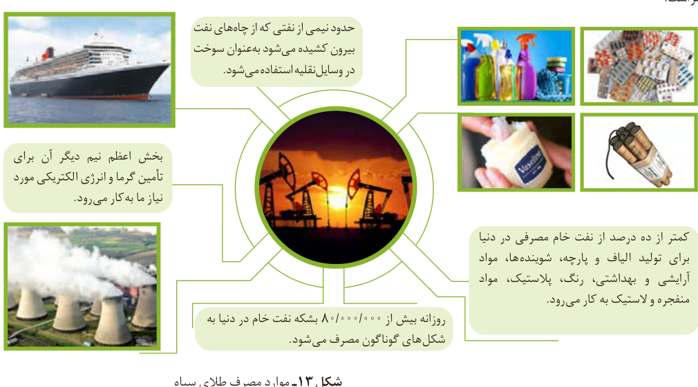

شیمی‌دان‌ها در آن زمان نمی‌دانستند که در این مخلوط سیاه رنگ چه موادی وجود دارد، این مواد چه خواصی دارند و هنگام انجام آزمایش و بررسی آن، چه اتفاقاتی ممکن است رخ دهد.

دیری نپایید که برخی شیمی‌دان‌ها با بررسی نفت خام، موفق به شناسایی برخی مواد سازنده آن، ساختار و رفتار آنها شدند. این ویژگی‌ها و رفتارها، چنان جذاب و غیرمنتظره بود که سبب افزایش چشمگیر پژوهش‌ها در مورد نفت خام در سراسر جهان شد. پژوهش‌هایی که با یافتن کاربردهای جدید و مناسب برای مواد موجود در نفت خام، خبرهای خوشی را نوید می‌داد. حل مشکل حمل و نقل از شهری به شهر دیگر یا از کشوری به کشور دیگر و ساخت داروهای تازه برای درمان بیماری‌های گوناگون از جمله آنها بود. بدین ترتیب آن مایع سیاه، نه تنها ترسناک و ناشناخته نماند بلکه به کیمیایی شگفت‌انگیز تبدیل شد. کیمیایی که از دل زمین بیرون کشیده می‌شد و به دلیل رفتارهایش، نظر همه جهانیان را به خود جلب کرد. امروزه این هدیه زمینی ارزشمند را طلای سیاه می‌نامند.

امروزه نفت خام در دنیای کنونی دو نقش اساسی ایفا می‌کند. نقش نخست آن، منبع تأمین انرژی بوده و در نقش دوم، ماده اولیه برای تهیه بسیاری از مواد و کالاهایی است که در صنایع گوناگون از آنها استفاده می‌شود (شکل ۱۳).

شکل ۱۳- موارد مصرف طلای سیاه

حدود نیمی از نفتی که از چاه‌های نفت بیرون کشیده می‌شود به‌عنوان سوخت در وسایل نقلیه استفاده می‌شود. بخش اعظم نیم دیگر آن برای تأمین گرما و انرژی الکتریکی مورد نیاز ما به کار می‌رود. کمتر از ده درصد از نفت خام مصرفی در دنیا برای تولید الیاف و پارچه، شوینده‌ها، مواد آرایشی و بهداشتی، رنگ، پلاستیک، مواد منفجره و لاستیک به کار می‌رود. روزانه بیش از ۸۰٬۰۰۰٬۰۰۰ بشکه نفت خام در دنیا به شکل‌های گوناگون مصرف می‌شود.

## آیا می‌دانید

نخستین چاه نفت جهان در سال ۱۸۵۹ میلادی در ایالت پنسیلوانیای آمریکا حفر شد. این چاه ۲۱ متر عمق داشت و روزانه بین ۲۰ تا ۴۰ بشکه نفت از آن بیرون کشیده می‌شد. نخستین چاه نفت ایران نیز در سال ۱۲۸۷ خورشیدی (۱۹۰۸ میلادی)، در شهر مسجد سلیمان حفر شد. هر بشکه نفت خام هم‌ارز با ۱۵۹ لیتر است.
