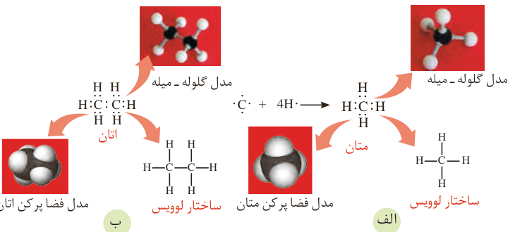

پژوهش‌ها و یافته‌های تجربی نشان می‌دهد که نفت خام، مخلوطی از هزاران ترکیب شیمیایی است که بخش عمده آن را هیدروکربن‌های گوناگون تشکیل می‌دهند. ترکیب‌هایی که شامل هیدروژن و کربن هستند. از آنجا که عنصر اصلی سازنده نفت خام کربن است، برای پی بردن به ویژگی‌ها و خواص مواد سازنده نفت خام، نخست باید با رفتارها و ویژگی‌های اتم کربن آشنا شد.

## کربن، اساس استخوان‌بندی هیدروکربن‌ها

عنصر کربن در خانه شماره ۶ جدول دوره‌ای جای داشته و اتم آن در لایه ظرفیت خود چهار الکترون دارد. این اتم رفتارهای منحصر به‌فردی دارد که آن را از اتم دیگر عنصرهای جدول متمایز می‌سازد. به‌طوری که ترکیب‌های شناخته شده از اتم کربن، از مجموع ترکیب‌های شناخته شده از دیگر عنصرهای جدول دوره‌ای بیشتر است. دلیل این رفتار ویژه چیست؟

## خود را بیازمایید

الف) آرایش الکترونی اتم کربن را بنویسید.

ب) آرایش الکترون نقطه‌ای اتم کربن را رسم کنید.

پ) اتم کربن برای رسیدن به آرایش هشت‌تایی چند پیوند اشتراکی یگانه، دوگانه یا سه‌گانه می‌تواند تشکیل دهد؟

دیدید که اتم کربن می‌تواند الکترون‌هایش را با اتم‌های دیگر به اشتراک بگذارد و با رسیدن به آرایش هشت‌تایی، پایدار شود (شکل ۱۴).

شکل ۱۴- پیوندهای اشتراکی یگانه اتم کربن در مولکول‌های متان (الف) و اتان (ب) و شیوه‌های گوناگون نمایش آنها

## آیا می‌دانید

اتم‌های کربن سازنده اصلی مولکول‌های زیستی و جهان زنده هستند. در حالی که در جهان غیرزنده، سیلیسیم عنصر اصلی سازنده مواد است.
