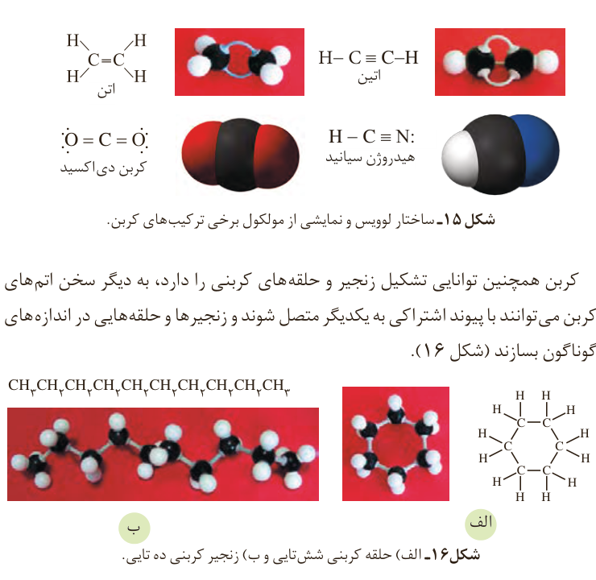

این رفتار کربن مشابه رفتار دیگر نافلزها (نیتروژن، فسفر، گوگرد و ...) است. برای مثال اتم نیتروژن ($_7\mathrm N$) سه پیوند اشتراکی تشکیل می‌دهد تا به آرایش هشت‌تایی برسد. اما تعداد ترکیب‌های شناخته شده از آن محدود است. اینک می‌پرسید چه چیزی سبب شده است تا اتم‌های کربن بتوانند میلیون‌ها ترکیب تشکیل دهند؟

اتم کربن افزون بر تشکیل پیوند اشتراکی یگانه، توانایی تشکیل پیوندهای اشتراکی دوگانه و سه‌گانه را با خود و برخی اتم‌های دیگر دارد (شکل ۱۵).

شکل ۱۵- ساختار لوویس و نمایشی از مولکول برخی ترکیب‌های کربن: اتن $\mathrm{H_2C{=}CH_2}$، اتین $\mathrm{HC{\equiv}CH}$، کربن دی‌اکسید $\mathrm{O{=}C{=}O}$ و هیدروژن سیانید $\mathrm{H{-}C{\equiv}N}$.

کربن همچنین توانایی تشکیل زنجیر و حلقه‌های کربنی را دارد، به دیگر سخن اتم‌های کربن می‌توانند با پیوند اشتراکی به یکدیگر متصل شوند و زنجیرها و حلقه‌هایی در اندازه‌های گوناگون بسازند (شکل ۱۶).

شکل ۱۶- الف) حلقه کربنی شش‌تایی و ب) زنجیر کربنی ده‌تایی.

نفت خام مخلوطی شامل شمار زیادی از انواع هیدروکربن¹ها است (شکل ۱۷). در این شکل پنج نوع از هیدروکربن‌ها نشان داده شده است. در برخی از آنها، بین اتم‌های کربن فقط پیوندهای یگانه وجود دارد، در حالی که برخی دیگر دارای یک پیوند سه‌گانه یا دارای یک یا چند پیوند دوگانه هستند. با توجه به ساختار متفاوت این هیدروکربن‌ها انتظار می‌رود که رفتار آنها نیز با هم تفاوت داشته باشد. در ادامه این فصل با بررسی ساختار و رفتار برخی هیدروکربن‌ها بیشتر آشنا می‌شوید.

۱- Hydrocarbon
