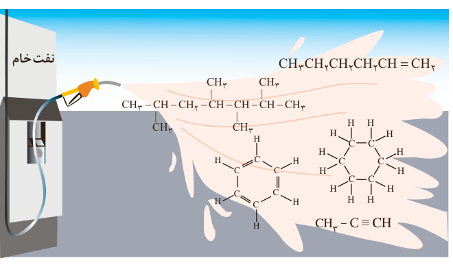

شکل ۱۷- برخی هیدروکربن‌های سازنده نفت خام

البته اتم کربن می‌تواند با اتم عنصرهای هیدروژن، اکسیژن، نیتروژن و ... به شیوه‌های گوناگون متصل شده و مولکول شمار زیادی از مواد مانند کربوهیدرات‌ها، چربی‌ها، آمینواسیدها، آنزیم‌ها، پروتئین‌ها و... را بسازد. این ویژگی‌های کربن سبب شده تا از این عنصر ترکیب‌های گوناگون و بسیار زیادی پدید آید. افزون بر این، اتم‌های کربن می‌توانند با یکدیگر به روش‌های گوناگون متصل شده و دگرشکل‌های متفاوتی مانند گرافیت، الماس و... ایجاد کنند. با این دگرشکل‌ها که ساختارها و خواص متفاوتی دارند، در سال آینده آشنا می‌شوید.

## آلکان‌ها، هیدروکربن‌هایی با پیوندهای یگانه

آلکان‌ها دسته‌ای از هیدروکربن‌ها هستند که در آنها هر اتم کربن با چهار پیوند یگانه به اتم‌های کناری متصل شده است. متان ($\mathrm{CH_4}$) ساده‌ترین و نخستین عضو خانواده آلکان‌هاست. اعضای دیگر این خانواده شامل مولکول‌هایی است که شمار اتم‌های کربن آنها از دو تا ده‌ها کربن متغیر است. اتم‌های کربن در ساختار آلکان‌ها می‌توانند پشت سر هم و همانند یک زنجیر به هم متصل شده باشند (شکل ۱۸- الف) هر چند که برخی از آنها به شکل شاخه جانبی به زنجیر متصل می‌شوند (شکل ۱۸- ب). با این توصیف در هر آلکان راست زنجیر هر اتم کربن به یک یا دو اتم کربن دیگر متصل است، در حالی که در آلکان شاخه‌دار، برخی کربن‌ها به سه یا چهار اتم کربن دیگر متصل‌اند.

## آیا می‌دانید

گاز شهری مخلوطی از هیدروکربن‌های سبک است که متان بخش عمده آن را تشکیل می‌دهد. در حالی که کپسول گاز خانگی، به‌طور عمده شامل گازهای پروپان و بوتان است.

۱- Alkane
