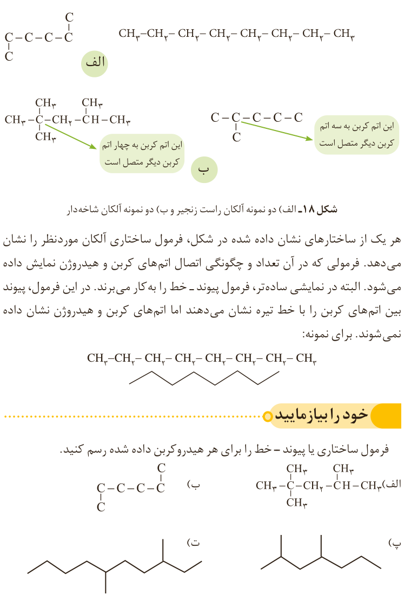

شکل ۱۸- الف) دو نمونه آلکان راست زنجیر و ب) دو نمونه آلکان شاخه‌دار. این اتم کربن به سه اتم کربن دیگر متصل است. این اتم کربن به چهار اتم کربن دیگر متصل است.

هر یک از ساختارهای نشان داده شده در شکل، فرمول ساختاری آلکان موردنظر را نشان می‌دهد. فرمولی که در آن تعداد و چگونگی اتصال اتم‌های کربن و هیدروژن نمایش داده می‌شود. البته در نمایشی ساده‌تر، فرمول پیوند ـ خط را به کار می‌برند. در این فرمول، پیوند بین اتم‌های کربن را با خط تیره نشان می‌دهند اما اتم‌های کربن و هیدروژن نشان داده نمی‌شوند. برای نمونه: $\mathrm{CH_3{-}CH_2{-}CH_2{-}CH_2{-}CH_2{-}CH_2{-}CH_2{-}CH_3}$

## خود را بیازمایید

فرمول ساختاری یا پیوند ـ خط را برای هر هیدروکربن داده شده رسم کنید. (ساختارهای الف، ب، پ و ت در تصویر.)

شمار اتم‌های کربن نقش مهمی در رفتار هیدروکربن‌ها دارد. به‌طوری که با تغییر تعداد اتم‌های کربن، اندازه و جرم مولکول‌های هیدروکربن تغییر می‌یابد و در پی آن نیروی بین مولکولی، نقطه جوش و... تغییر می‌کنند. با انجام دادن فعالیت صفحه بعد با برخی رفتارهای هیدروکربن‌ها آشنا می‌شوید.

نمونه‌ای از آلکان شاخه‌دار (۱) و دو نمونه از آلکان‌های راست زنجیر (۲ و ۳). توجه کنید آلکان (۳) شاخه‌دار به نظر می‌آید، اما شاخه‌دار نبوده بلکه راست زنجیر است.
