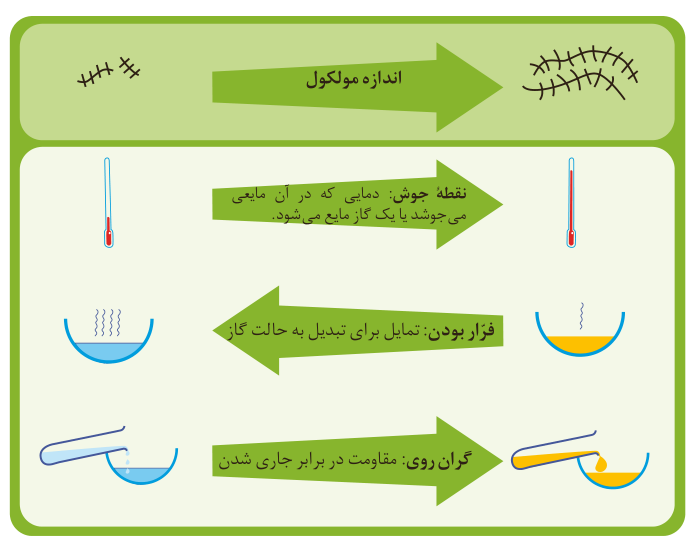

## با هم بیندیشیم

۱- شکل زیر برخی ویژگی‌ها و رفتارهای فیزیکی آلکان‌های راست زنجیر را نشان می‌دهد. با توجه به آن به پرسش‌ها پاسخ دهید:

نقطه جوش: دمایی که در آن مایعی می‌جوشد یا یک گاز مایع می‌شود. فرار بودن: تمایل برای تبدیل به حالت گاز. گران‌روی: مقاومت در برابر جاری شدن.

الف) با افزایش شمار کربن‌ها، نقطه جوش آلکان‌ها در فشار یک اتمسفر چه تغییری می‌کند؟

ب) پیش‌بینی کنید نقطه جوش کدام آلکان بالاتر است؟ $\mathrm{C_{21}H_{44}}$ یا $\mathrm{C_{12}H_{26}}$

پ) در شرایط یکسان کدام آلکان فرارتر است؟ چرا؟ $\mathrm{C_6H_{14}}$ یا $\mathrm{C_{10}H_{22}}$

ت) پژوهش‌ها نشان می‌دهد که گشتاور دوقطبی آلکان‌ها حدود صفر است. با این توصیف مولکول‌های این مواد، قطبی یا ناقطبی هستند؟

ث) نیروی بین مولکولی در آلکان‌ها از چه نوعی است؟ افزایش شمار اتم‌های کربن بر این نیروها چه اثری دارد؟

ج) چرا با بزرگ‌تر شدن زنجیر کربنی، گران‌روی آلکان افزایش می‌یابد؟

چ) پیش‌بینی کنید کدام ماده چسبنده‌تر است؟ چرا؟ گریس (با فرمول تقریبی $\mathrm{C_{18}H_{38}}$) یا وازلین (با فرمول تقریبی $\mathrm{C_{25}H_{52}}$).
