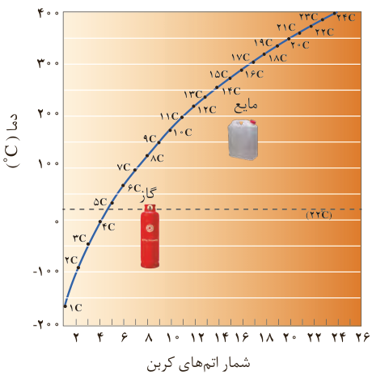

۲- نمودار زیر ترتیب نقطه جوش آلکان‌های راست زنجیر را نشان می‌دهد. با توجه به آن:

الف) کدام آلکان‌ها در دمای ۲۲ °C به حالت گاز هستند؟

ب) رابطه بین نقطه جوش و جرم مولی آلکان‌ها را توصیف کنید.

## پیوند با ریاضی

در جدول زیر نام، فرمول مولکولی و شمار اتم‌های کربن و هیدروژن برای برخی اعضای خانواده آلکان‌ها داده شده است. جدول را کامل کنید و فرمول مولکولی عضو nام را بیابید.

| شماره عضو | اول | دوم | سوم | چهارم | پنجم | ... | nام |
|---|---|---|---|---|---|---|---|
| نام | متان | اتان | پروپان | بوتان | پنتان | | |
| شمار C | | | | | | | |
| شمار H | | | | | | | |
| فرمول | $\mathrm{CH_4}$ | $\mathrm{C_2H_6}$ | $\mathrm{C_3H_8}$ | $\mathrm{C_4H_{10}}$ | $\mathrm{C_5H_{12}}$ | | |

آلکان‌ها به دلیل ناقطبی بودن در آب نامحلول‌اند. این ویژگی سبب می‌شود تا بتوان از آنها برای حفاظت از فلزها استفاده کرد. به‌طوری که قرار دادن فلزها در آلکان‌های مایع یا اندود کردن سطح فلزها و وسایل فلزی با آنها، مانع از رسیدن آب به سطح فلز می‌شود و از

## آیا می‌دانید

وازلین نامی تجاری است که به مخلوطی از هیدروکربن‌های سنگین‌تر داده شده است. این هیدروکربن‌ها اغلب به‌عنوان نرم‌کننده و محافظ بدن استفاده می‌شوند. این مخلوط ویژگی روان‌کنندگی نیز دارد و در تهیه بیشتر مرطوب‌کننده‌ها، پمادها و مواد آرایشی به کار می‌رود. سوخت فندک، گاز بوتان بوده و تحت فشار پر شده است.
