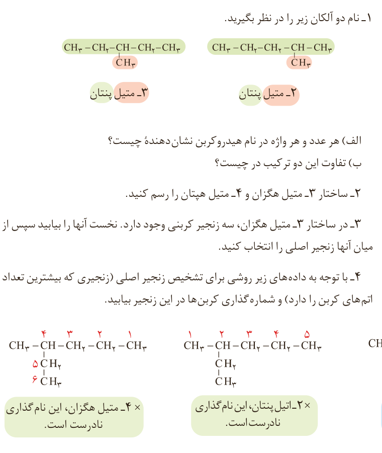

مطابق جدول بر اساس قواعد آیوپاک برای نامیدن آلکان راست زنجیر کافی است شمار اتم‌های کربن را با پیشوند معادل بیان کرده و پسوند «ان» را بیفزایید. توجه کنید که در چهار عضو نخست آلکان‌ها، پیشوندی که شمار اتم‌های کربن را معلوم کند، وجود ندارد و نام آنها بر اساس این روش انتخاب نشده است.

اما نام‌گذاری آلکان‌های شاخه‌دار کمی پیچیده‌تر است. از این رو آیوپاک قواعد بیشتری را برای نامیدن آلکان‌ها بنا نهاده است. در این قواعد چگونگی یافتن نوع و نام شاخه فرعی و جهت شماره‌گذاری زنجیر اصلی مشخص شده است.

| پیشوند | تعداد کربن |
|---|---|
| پنت | ۵ |
| هگز | ۶ |
| هپت | ۷ |
| اوکت | ۸ |
| نون | ۹ |
| دک | ۱۰ |

| نام شاخه فرعی | فرمول شاخه فرعی (آلکیل) |
|---|---|
| متیل | $\mathrm{{-}CH_3}$ |
| اتیل | $\mathrm{{-}CH_2CH_3}$ |

| پیشوند | معنی |
|---|---|
| دی | دو |
| تری | سه |
| تترا | چهار |

## با هم بیندیشیم

۱- نام دو آلکان زیر را در نظر بگیرید: ۲-متیل پنتان و ۳-متیل پنتان.

الف) هر عدد و هر واژه در نام هیدروکربن نشان‌دهنده چیست؟

ب) تفاوت این دو ترکیب در چیست؟

۲- ساختار ۳-متیل هگزان و ۴-متیل هپتان را رسم کنید.

۳- در ساختار ۳-متیل هگزان، سه زنجیر کربنی وجود دارد. نخست آنها را بیابید سپس از میان آنها زنجیر اصلی را انتخاب کنید.

۴- با توجه به داده‌های زیر روشی برای تشخیص زنجیر اصلی (زنجیری که بیشترین تعداد اتم‌های کربن را دارد) و شماره‌گذاری کربن‌ها در این زنجیر بیابید.

۳-متیل هگزان صحیح؛ ۲-اتیل پنتان و ۴-متیل هگزان نام‌گذاری نادرست است.
