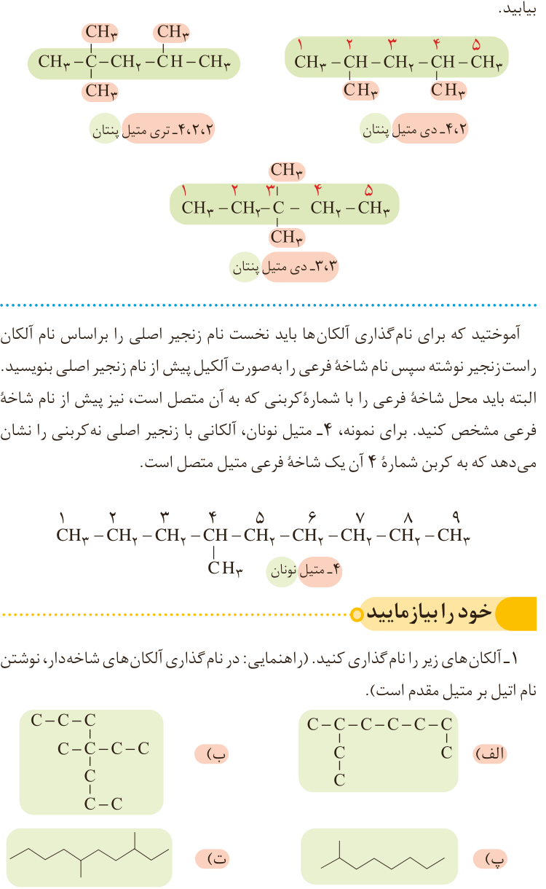

۵- با توجه به نام‌گذاری زیر، روشی برای نامیدن آلکان‌های با بیش از یک شاخه فرعی را بیابید.

۲،۴-دی‌متیل پنتان؛ ۲،۲،۴-تری‌متیل پنتان؛ ۳،۳-دی‌متیل پنتان.

آموختید که برای نام‌گذاری آلکان‌ها باید نخست نام زنجیر اصلی را براساس نام آلکان راست زنجیر نوشته سپس نام شاخه فرعی را به‌صورت آلکیل پیش از نام زنجیر اصلی بنویسید. البته باید محل شاخه فرعی را با شماره کربنی که به آن متصل است، نیز پیش از نام شاخه فرعی مشخص کنید. برای نمونه، ۴-متیل نونان، آلکانی با زنجیر اصلی نه کربنی را نشان می‌دهد که به کربن شماره ۴ آن یک شاخه فرعی متیل متصل است.

در این کتاب فقط قواعد نام‌گذاری آلکان‌ها بررسی و تدریس می‌شود. بدیهی است نام‌گذاری دیگر مواد آلی هدف آموزشی نبوده و ارزشیابی از آنها ممنوع است.

## خود را بیازمایید

۱- آلکان‌های زیر را نام‌گذاری کنید. (راهنمایی: در نام‌گذاری آلکان‌های شاخه‌دار، نوشتن نام اتیل بر متیل مقدم است.) ساختارهای الف، ب، پ و ت در تصویر آمده‌اند.
