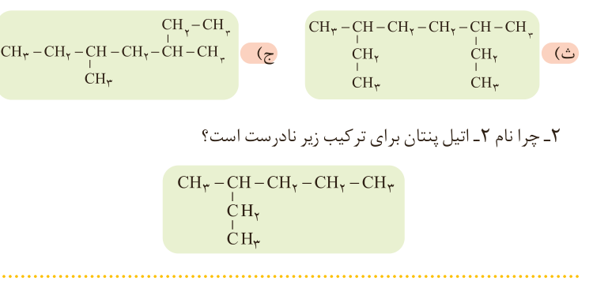

۲- چرا نام ۲-اتیل پنتان برای ترکیب زیر نادرست است؟

## آلکن‌ها، هیدروکربن‌هایی با یک پیوند دوگانه

این هیدروکربن‌ها در ساختار خود یک پیوند دوگانه کربن–کربن ($\mathrm{C{=}C}$) دارند. برای نام‌گذاری آلکن‌های راست زنجیر، کافی است پسوند «ان» را در نام آلکان راست زنجیر بردارید و به جای آن پسوند «ن» قرار دهید؛ سپس محل پیوند دوگانه را با شماره نخستین کربنی که به پیوند دوگانه متصل است، مشخص کنید (شکل ۱۹).

اتن: $\mathrm{CH_2{=}CH_2}$؛ پروپن: $\mathrm{CH_3{-}CH{=}CH_2}$؛ ۱-بوتن: $\mathrm{CH_3{-}CH_2{-}CH{=}CH_2}$؛ ۲-بوتن: $\mathrm{CH_3{-}CH{=}CH{-}CH_3}$؛ ۱-هگزن: $\mathrm{CH_3{-}CH_2{-}CH_2{-}CH_2{-}CH{=}CH_2}$.

شکل ۱۹- نام و ساختار چند آلکن راست زنجیر

اتن نخستین عضو خانواده آلکن‌هاست. این ماده در بیشتر گیاهان وجود دارد. موز و گوجه‌فرنگی رسیده گاز اتن آزاد می‌کنند. اتن آزاد شده از یک موز یا گوجه‌فرنگی رسیده به نوبه خود موجب رسیدن سریع‌تر میوه‌های نارس می‌شود. به همین دلیل در کشاورزی، از گاز اتن به‌عنوان «عمل‌آورنده» استفاده می‌شود (شکل ۲۰).

شکل ۲۰- کاربردی از گاز اتن

در گذشته گاز اتن را با نام گاز اتیلن می‌خواندند.

۱- Alkene
