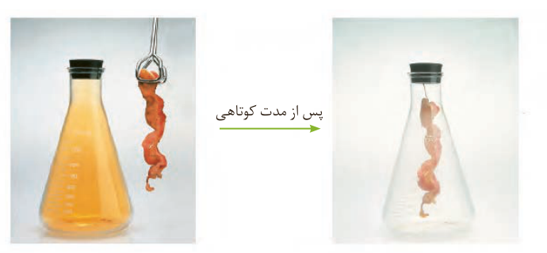

## خود را بیازمایید

شکل زیر نمایی از واکنش تکه‌ای گوشت چرب با بخار برم را نشان می‌دهد. با توجه به آن پیش‌بینی کنید مولکول چربی موجود در این گوشت سیر شده است یا سیر نشده؟ چرا؟ (راهنمایی: در این واکنش تنها چربی موجود در گوشت با بخار برم واکنش می‌دهد.)

پلیمری شدن دسته دیگری از واکنش آلکن‌هاست که با استفاده از آن می‌توان انواع لاستیک‌ها، پلاستیک‌ها، الیاف و پلیمرهای سودمند را تهیه کرد. این واکنش‌ها در فصل ۳ بررسی خواهد شد.

## آلکین‌ها، سیرنشده‌تر از آلکن‌ها

آیا واژه جوش کاربیدی را شنیده‌اید؟ در این جوشکاری از سوختن گاز اتین، دمای لازم برای جوش دادن قطعه‌های فلزی تأمین می‌شود. اتین هیدروکربنی است که در ساختار خود یک پیوند سه‌گانه کربن–کربن دارد.

به هیدروکربن‌های سیر نشده با یک پیوند سه‌گانه کربن–کربن، آلکین گفته می‌شود. برای نام‌گذاری آنها به‌جای پسوند «ان» در نام آلکان هم‌کربن، پسوند «ین» قرار می‌گیرد. اتین با فرمول مولکولی $\mathrm{C_2H_2}$ ساده‌ترین آلکین و پروپین دومین عضو خانواده آلکین‌ها است. از نام پروپین چنین برمی‌آید که هر مولکول آن سه کربن داشته و یک پیوند سه‌گانه میان دو کربن آن وجود دارد.

پروپین: $\mathrm{CH_3{-}C{\equiv}CH}$

آلکین‌ها نیز واکنش‌پذیری زیادی دارند و با مواد شیمیایی مختلف واکنش می‌دهند.

جوش‌کاری و برش‌کاری فلزها با سوزاندن گاز اتین. در گذشته گاز اتین را با نام گاز استیلن می‌خواندند. نمایشی از مولکول اتین.

۱- Alkyne
