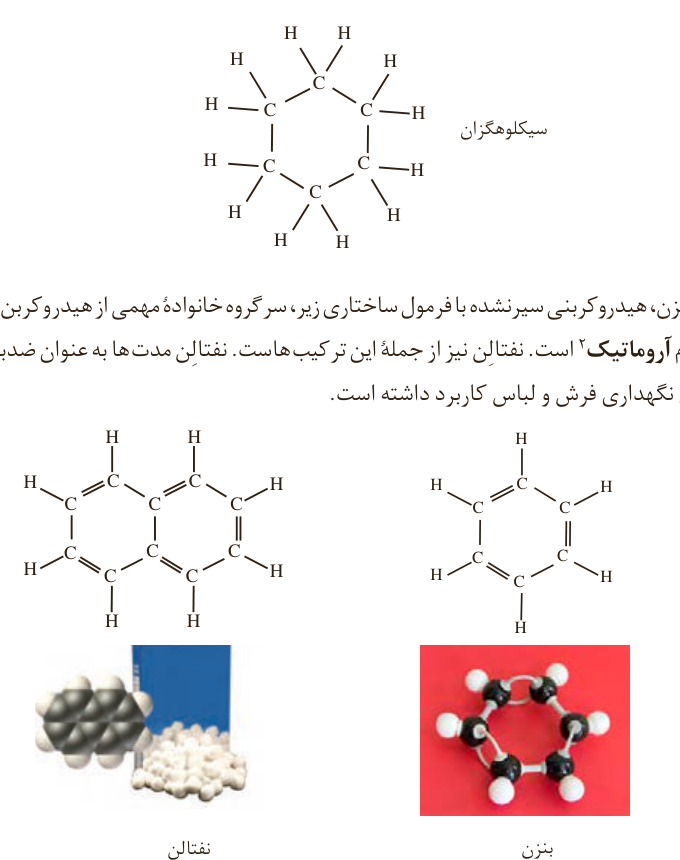

## هیدروکربن‌های حلقوی¹

ترکیب‌های آلی بسیاری شناخته شده است که در آنها اتم‌های کربن طوری به یکدیگر متصل شده‌اند که ساختاری حلقوی به وجود آورده‌اند. سیکلوهگزان از آن جمله است. این نام نشان می‌دهد که این ماده، هیدروکربن سیر شده‌ای است که حلقه‌ای از شش اتم کربن دارد.

بنزن، هیدروکربنی سیرنشده با فرمول ساختاری زیر، سرگروه خانواده مهمی از هیدروکربن‌ها به نام آروماتیک² است. نفتالین نیز از جمله این ترکیب‌هاست. نفتالین مدت‌ها به عنوان ضدبید برای نگه‌داری فرش و لباس کاربرد داشته است.

سیکلو (Cyclo) پیشوندی به معنای حلقوی است که برای نام‌گذاری برخی ترکیب‌های آلی حلقوی به کار می‌رود.

## خود را بیازمایید

الف) فرمول مولکولی هر یک از هیدروکربن‌های حلقوی بالا را بنویسید.

ب) فرمول پیوند ـ خط را برای هر یک از آنها رسم کنید.

۱- Cyclic Hydrocarbons  
۲- Aromatic
