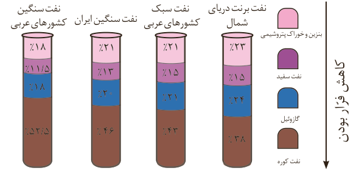

## نفت، ماده‌ای که اقتصاد جهان را دگرگون ساخت

نفت خام مخلوطی از هیدروکربن‌های گوناگون، برخی نمک‌ها، اسیدها، آب و... است. البته مقدار نمک و اسید در نفت خام کم بوده و در نواحی گوناگون متغیر است. (چرا؟) آلکان‌ها بخش عمده هیدروکربن‌های موجود در نفت خام را تشکیل می‌دهند و به دلیل واکنش‌پذیری کم اغلب به‌عنوان سوخت به کار می‌روند، به‌طوری که بیش از ۹۰ درصد نفت خام صرف سوزاندن و تأمین انرژی می‌شود و تنها مقدار کمی از آن به‌عنوان خوراک پتروشیمی در تولید مواد پتروشیمیایی به کار می‌رود. همان‌طور که در شکل روبه‌رو مشاهده می‌کنید از نفت خام دسته‌های متفاوتی از هیدروکربن‌ها به دست می‌آید. ترکیب‌های موجود در این دسته‌ها چه ویژگی‌هایی دارند؟ جداسازی آنها از نفت خام بر چه مبنایی و با چه دستگاهی انجام می‌شود؟

## با هم بیندیشیم

در شکل زیر چهار نوع نفت خام بر اساس درصد اجزای سازنده مقایسه شده‌اند. با توجه به آن به پرسش‌ها پاسخ دهید.

الف) اندازه مولکول‌های نفت کوره با بنزین چه تفاوتی دارد؟

ب) کدام دسته از مواد در نفت سنگین بیشتر از نفت سبک وجود دارد؟

پ) ملاک دسته‌بندی نفت خام به دو دسته سبک و سنگین چیست؟

ت) چرا قیمت نفت برنت دریای شمال از دیگر نفت‌ها بیشتر اما قیمت نفت سنگین کشورهای عربی کمتر است؟

## آیا می‌دانید

خلیج فارس یکی از پررفت‌وآمدترین مناطق دریایی جهان است و سالانه هزاران کشتی اقیانوس‌پیما وارد این منطقه می‌شوند. سوخت این کشتی‌ها نفت کوره است و می‌توانند سوخت مورد نیاز خود را در شمال خلیج فارس دریافت کنند و به سفر دریایی خود ادامه دهند. از این رو سوخت‌رسانی به این کشتی‌ها یکی از مهم‌ترین زمینه‌های ارزآوری و اشتغال‌زایی صنایع دریایی می‌تواند باشد. کشور ایران با توجه به موقعیت جغرافیایی ویژه در خلیج فارس می‌تواند سهم زیادی از این منافع را نصیب خود کند.
