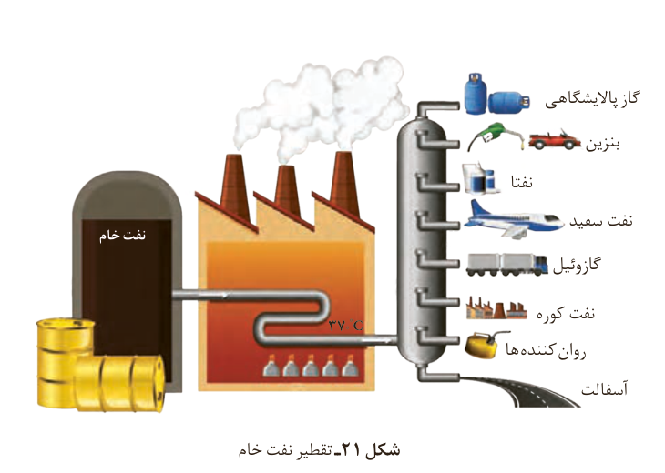

پس از جدا کردن نمک‌ها، اسیدها و آب، نفت خام را پالایش¹ می‌کنند. در واقع با استفاده از تقطیر جزء به جزء، هیدروکربن‌های آن را به صورت مخلوط‌هایی با نقطه جوش نزدیک به‌هم جدا می‌کنند. برای این کار، نفت خام را درون محفظه‌ای بزرگ گرما می‌دهند و آن را به برج تقطیر (شکل ۲۱) هدایت می‌کنند. برجی که در آن از پایین به بالا دما کاهش می‌یابد. هنگامی که نفت خام داغ به قسمت پایین برج وارد می‌شود، مولکول‌های سبک‌تر و فرارتر از جمله مواد پتروشیمیایی، از مایع بیرون آمده و به سوی بالای برج حرکت می‌کنند. به تدریج که این مولکول‌ها بالاتر می‌روند، سرد شده و به مایع تبدیل می‌شوند و در سینی‌هایی که در فاصله‌های گوناگون برج قرار دارند، وارد شده و از برج خارج می‌شوند. بدین ترتیب مخلوط‌هایی با نقطه جوش نزدیک به‌هم از نفت خام جداسازی می‌شوند.

شکل ۲۱- تقطیر نفت خام: گاز پالایشگاهی، بنزین، نفتا، نفت سفید، گازوئیل، نفت کوره، روان‌کننده‌ها و آسفالت.

دستیابی به دانش و فناوری پالایش نفت خام، سبب ایجاد تحولی بزرگ در صنعت حمل‌ونقل، پتروشیمی و دیگر صنایع شد. پالایش نفت خام، از سویی سوخت ارزان و مناسب را در اختیار صنایع قرار می‌داد و از سوی دیگر، منجر به تولید انرژی الکتریکی ارزان قیمت می‌شد. همه این روندها سبب شد تا ارزش و اهمیت طلای سیاه روز به روز بیشتر شود تا جایی که استفاده و شناخت بیشتر آن، چهره زندگی را آشکارا تغییر داد. این هدیه الهی در سده گذشته کانون توجه و تحولات اجتماعی، سیاسی و اقتصادی در سطح جهان بود؛ اما استخراج و مصرف بی‌حساب این منبع خدادادی سبب شده تا این اندوخته رو به پایان باشد (نمودار ۲).

## آیا می‌دانید

سهم کشورهای عضو اوپک از ذخایر نفت جهان به شرح زیر است: کشورهای عضو اوپک ۸۱٪، سایر کشورها ۱۹٪. اعضای نشان داده شده: الجزایر، آنگولا، اکوادور، گابن، اندونزی، ایران، عراق، کویت، لیبی، نیجریه، قطر، عربستان سعودی، امارات متحده عربی، ونزوئلا.

۱- Refining
