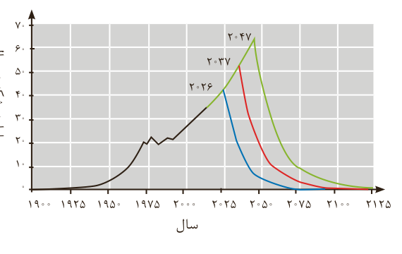

نمودار ۲- مقدار نفت خام تولید شده (خط سیاه) و برآورد شده (خط‌های آبی، قرمز و سبز). خط آبی کمترین، خط سبز بیشترین و خط قرمز میانگین برآورد.

## در میان تارنماها

● با مراجعه به وبگاه www.worldmeters.info/fa مصرف لحظه‌ای نفت خام و سوخت‌های فسیلی را مشاهده کنید.

یکی از سوخت‌های فسیلی، زغال‌سنگ است که طول عمر ذخایر آن به ۵۰۰ سال می‌رسد؛ از این‌رو می‌تواند به‌عنوان سوخت، جایگزین نفت شود. اما جایگزینی نفت با زغال‌سنگ سبب ورود مقدار بیشتری از انواع آلاینده‌ها به هواکره شده و تشدید اثر گلخانه‌ای می‌شود (جدول ۱). چرا؟

جدول ۱- مقایسه بنزین با زغال‌سنگ

| نام سوخت | گرمای آزاد شده (kJ/g) | فرآورده‌های سوختن | مقدار کربن دی‌اکسید به ازای هر کیلوژول انرژی تولید شده (g) |
|---|---|---|---|
| بنزین | ۴۸ | $\mathrm{CO_2, CO, H_2O}$ | ۰/۰۶۵ |
| زغال‌سنگ | ۳۰ | $\mathrm{SO_2, CO_2, NO_2, CO, H_2O}$ | ۰/۱۰۴ |

بنابراین باید به دنبال راه‌های بهبود کارایی زغال‌سنگ مانند موارد زیر باشیم.

● شست‌وشوی زغال‌سنگ به‌منظور حذف گوگرد و ناخالصی‌های دیگر

● به دام انداختن گاز گوگرد دی‌اکسید خارج شده از نیروگاه‌ها با عبور گازهای خروجی از روی کلسیم اکسید

$\mathrm{SO_2(g)+CaO(s)\longrightarrow CaSO_3(s)}$

## آیا می‌دانید

فرمول کلی زغال‌سنگ را به‌صورت $\mathrm{C_{135}H_{96}O_9NS}$ برآورد می‌کنند. زغال‌سنگ پراکندگی نسبتاً مناسبی در سراسر جهان دارد و تقریباً در همه کشورها یافت می‌شود. جزء اصلی سازنده زغال‌سنگ کربن است، به‌طوری که بیش از ۸۰ درصد آن را کربن تشکیل می‌دهد. زغال‌سنگ نیز مخلوطی از ترکیب‌های گوناگون است که به مقدار قابل توجهی عنصرهای دیگری مانند گوگرد، نیتروژن و اکسیژن نیز دارد. البته در زغال‌سنگ مقدار کمی از فلزهای گوناگون مانند نیکل، مس، آلومینیم، سرب، آرسنیک، جیوه و... وجود دارد. مقدار جیوه در زغال‌سنگ ۰/۵–۲ ppm است. با این توصیف، نیروگاه‌هایی که زغال‌سنگ می‌سوزانند روزانه هزاران گرم جیوه به هواکره وارد می‌کنند.
