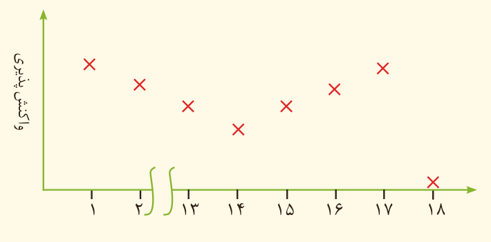

## تمرین‌های دوره‌ای

۱- یون سولفات موجود در ۲/۴۵ g از نمونه‌ای کود شیمیایی را با استفاده از یون باریم، جداسازی کرده و ۲/۱۸ گرم باریم سولفات به‌دست آمده است. درصد خلوص کود شیمیایی را بر حسب یون سولفات حساب کنید.

۲- از واکنش ۸/۱ گرم فلز آلومینیم با خلوص ۹۰ درصد با محلول مس (II) سولفات مطابق واکنش زیر، چند گرم فلز مس آزاد می‌شود؟

$\mathrm{2Al(s)+3CuSO_4(aq)\longrightarrow 3Cu(s)+Al_2(SO_4)_3(aq)}$

۳- سیلیسیم عنصر اصلی سازنده سلول‌های خورشیدی است که از واکنش زیر تهیه می‌شود.

$\mathrm{SiO_2(s)+2C(s)\xrightarrow{\Delta} Si(l)+2CO(g)}$

الف) واکنش‌پذیری کربن را با سیلیسیم مقایسه کنید.

ب) مقدار ناخالصی در ۱۰۰ گرم سیلیسیم مصرفی در صنایع الکترونیک ۰/۰۰۰۱ گرم است. درصد خلوص آن را حساب کنید.

۴- نمودار زیر روند کلی تغییر واکنش‌پذیری عنصرهای دوره دوم جدول دوره‌ای را نشان می‌دهد.

الف) چرا واکنش‌پذیری عنصرهای گروه ۱۸ در حدود صفر است؟

ب) روند تغییر واکنش‌پذیری را توضیح دهید.
