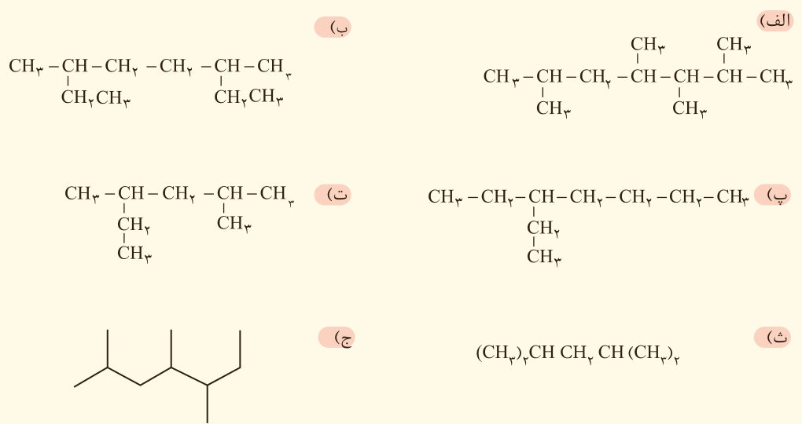

۵- هر یک از هیدروکربن‌های زیر را به روش آیوپاک نام‌گذاری کنید.

۶- با توجه به واکنش‌های زیر به پرسش‌های مطرح شده پاسخ دهید.

$\mathrm{1)\ TiCl_4+Mg\xrightarrow{\Delta} Ti+MgCl_2}$

$\mathrm{2)\ Fe_2O_3+Ti\xrightarrow{\Delta} Fe+TiO_2}$

الف) هر یک از آنها را موازنه کنید.

ب) ترتیب واکنش‌پذیری عنصرهای Mg، Fe و Ti را مشخص کنید.

پ) برای تهیه فلز تیتانیم، باید واکنش شماره (۱) را در حضور گاز آرگون انجام داد. چرا وجود گازهای اکسیژن و نیتروژن در محیط واکنش مانع از انجام واکنش می‌شود؟ (توجه: گاز نیتروژن به جو بی‌اثر معروف است.)

ت) پیش‌بینی کنید آیا واکنش زیر در شرایط مناسب انجام می‌شود؟ چرا؟ در صورت انجام، آن را کامل و موازنه کنید.

$\mathrm{Mg+Fe_2O_3\xrightarrow{\Delta}\ldots+\ldots}$

ث) تیتانیم فلزی محکم، با چگالی کم و مقاوم در برابر خوردگی است. یکی از کاربردهای آن استفاده در بدنه دوچرخه است. اگر در کارخانه‌ای از مصرف $3.54\times10^7$ گرم تیتانیم (IV) کلرید، $7.91\times10^6$ گرم فلز تیتانیم به‌دست آید، بازده درصدی واکنش را حساب کنید.
