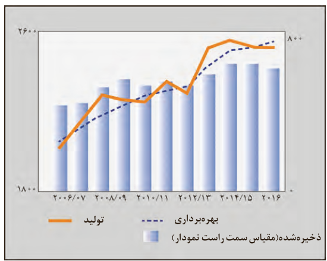

غذا¹ همواره نقش محوری در رشد، تندرستی و زندگی انسان داشته است. بررسی‌ها نشان می‌دهد که نیاکان ما بیشتر وقت خود را صرف تهیه وعده‌های غذایی می‌کردند؛ آن چنان که در طول روز اغلب در جست‌وجوی غذا و جمع‌آوری دانه‌های خوراکی بودند. آنها به تدریج یاد گرفتند که دانه‌ها را بکارند و فرآورده‌ها را درو کنند. فرایندی که نخستین انقلاب در کشاورزی بود و باعث شد انسان‌ها حبوبات، غلات و... را به مقدار زیادی تولید کنند. اما افزایش جمعیت جهان عاملی تعیین‌کننده بوده و هست، به‌طوری که امروزه تأمین غذای حدود ۸/۳ میلیارد نفر ساکن کره زمین بسیار پیچیده و دشوار است، زیرا برای انجام این مهم سالانه بایستی حجم انبوهی از غلات، حبوبات، مواد پروتئینی و... تولید شود. نمودار ۱ تولید و مصرف جهانی غلات را در یک دهه نشان می‌دهد.

نمودار ۱- تولید و مصرف جهانی غلات در یک دهه

اینک می‌پذیرید که یکی از مهم‌ترین و شاید دشوارترین مسئولیت هر دولت، تأمین غذای افراد جامعه است. مسئولیتی که یکی از چالش‌های نگران‌کننده در عصر کنونی است.

برای تولید غذا در حجم انبوه به فعالیت‌های صنعتی گوناگونی مانند تولید، حمل‌ونقل، نگه‌داری، فراوری و... نیاز است؛ مجموعه حوزه‌هایی که صنایع غذایی نامیده می‌شوند. در این صنعت نیز همانند دیگر صنایع منابع شیمیایی بسیاری، سطح وسیعی از زمین‌های بایر و حجم عظیمی از آب‌های قابل استفاده در کشاورزی مصرف می‌شود. این نیازها تأیید می‌کند که یکی از مهم‌ترین و شاید سنگین‌ترین مسئولیت‌های هر دولت، تأمین غذای افراد جامعه است. مسئولیتی که در گذشته با قحطی و جنگ غذا تهدید می‌شد و امروزه نیز چالشی نگران‌کننده به شمار می‌رود.

## آیا می‌دانید

میزان تولید گندم ایران در سال ۱۴۰۳ به بیش از ۱۵ میلیون تن رسید. میزان تولید برنج ایران در سال ۱۴۰۳ به حدود ۲/۷ میلیون تن رسید.

پیشرفت دانش و فناوری موجب شده است که تولید فرآورده‌های کشاورزی و دامی افزایش یابد و غذا به روش صنعتی تولید شود. در تولید انبوه، به دلیل فساد مواد غذایی و دشواری نگهداری آنها، حفظ کیفیت و ارزش مواد غذایی اهمیت بسزایی دارد.

۱- Food
