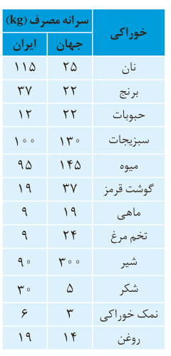

## خود را بیازمایید

جدول روبه‌رو، سرانه مصرف سالانه برخی مواد خوراکی را نشان می‌دهد. با توجه به آن، به پرسش‌های مطرح شده پاسخ دهید.

| خوراکی | سرانه مصرف جهان (kg) | سرانه مصرف ایران (kg) |
|---|---|---|
| نان | ۲۵ | ۱۱۵ |
| برنج | ۲۲ | ۳۷ |
| حبوبات | ۲۲ | ۱۲ |
| سبزیجات | ۱۳۰ | ۱۰۰ |
| میوه | ۱۴۵ | ۹۵ |
| گوشت قرمز | ۳۷ | ۱۹ |
| ماهی | ۱۹ | ۹ |
| تخم مرغ | ۲۴ | ۹ |
| شیر | ۳۰۰ | ۹۰ |
| شکر | ۵ | ۳۰ |
| نمک خوراکی | ۳ | ۶ |
| روغن | ۱۴ | ۱۹ |

الف) دیابت بزرگسالی یکی از بیماری‌های شایع در ایران است. مصرف بی‌رویه کدام مواد در گسترش این بیماری نقش دارد؟

ب) گوشت قرمز و ماهی افزون بر پروتئین¹، محتوی انواع ویتامین² و مواد معدنی³ است. چه پیشنهادهایی برای گنجاندن آنها در برنامه غذایی خانواده خود دارید؟

پ) شیر و فرآورده‌های آن، منبع مهمی برای تأمین پروتئین و به‌ویژه کلسیم است. کارشناسان تغذیه بر مصرف مناسب آنها برای پیشگیری و ترمیم پوکی استخوان تأکید دارند. اگر شما یک مدیر تصمیم‌گیرنده در کشور باشید، چه راهکارهایی برای افزایش مصرف آنها ارائه می‌کنید؟

ت) کارشناسان تغذیه بر مصرف حبوبات مانند نخود، لوبیا، عدس و... در برنامه غذایی تأکید دارند زیرا سرشار از مواد مغذی هستند. براساس برنامه غذایی خانواده خود چه پیشنهادی برای افزایش مصرف آنها دارید؟

سرانه مصرف ماده غذایی، مقدار میانگین مصرف آن را به ازای هر فرد در یک گستره زمانی معین نشان می‌دهد.

## آیا می‌دانید

سازمان جهانی خواربار و کشاورزی (FAO)⁴ در راستای بالا بردن سطح زندگی و بهبود تغذیه، توزیع مناسب مواد غذایی و ایجاد امنیت غذایی در جهان فعالیت می‌کند. این سازمان در شهر رم، پایتخت کشور ایتالیا قرار دارد. برخی آمارهای این سازمان براساس مصرف سرانه مواد غذایی است.

آیا تاکنون اندیشیده‌اید که نقش غذا در بدن چیست؟ آیا غذا چیزی فراتر از یک پاسخ به احساس گرسنگی است؟ پژوهش‌ها و یافته‌های تجربی نشان می‌دهند که مصرف غذا، انرژی مورد نیاز بدن برای حرکت ماهیچه‌ها، ارسال پیام‌های عصبی، جابه‌جایی یون‌ها و مولکول‌ها از دیواره هر یاخته را تأمین می‌کند. غذا همچنین مواد اولیه برای ساخت و رشد بخش‌های گوناگون بدن مانند سلول‌های خونی، استخوان، پوست، مو، ماهیچه‌ها، آنزیم‌ها و... را فراهم می‌کند. همه این فرایندها

۱- Protein  
۲- Vitamin  
۳- Minerals  
۴- Food and Agriculture Organization
