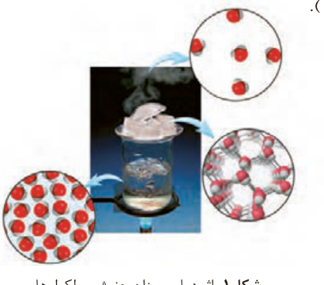

ماکارونی و گردو نیز هنگام سوختن، انرژی آزاد می‌کنند. در واقع هر ماده غذایی انرژی دارد و میزان انرژی آن به جرمی بستگی دارد که می‌سوزد، انرژی‌ای که می‌تواند باعث تغییر دما شود. اما اینکه دمای یک ماده چه چیزی را نشان می‌دهد و با انرژی چه رابطه‌ای دارد، هدفی است که در ادامه دنبال خواهد شد.

## دمای یک ماده از چه خبر می‌دهد؟

نوشیدن چای داغ و آب خنک به ترتیب در هوای سرد و هوای گرم، لذت‌بخش است. در این تجربه‌های خوشایند «داغی یا خنکی نوشیدنی» و «سردی یا گرمی هوا» نشانه‌ای از تفاوت میان دمای آنهاست، کمیتی که میزان گرمی و سردی مواد را نشان می‌دهد. از آنجا که در شیمی بررسی ساختار مواد و فرایندها از دیدگاه ذره‌ای اهمیت و جایگاه ویژه‌ای دارد، نخست باید با مفهوم دما¹ از این دیدگاه آشنا شوید. برای درک آسان‌تر آن، تجربه زیر را به دقت بررسی کنید (شکل ۱).

شکل ۱- اثر دما بر میزان جنبش مولکول‌ها

مطابق شکل ۱، هنگامی که به ظرف محتوی آب گرما داده می‌شود، به تدریج دمای آن افزایش می‌یابد تا اینکه سرانجام آب می‌جوشد و یخ موجود در بالای آن نیز ذوب می‌شود. آیا می‌دانید جنب‌وجوش مولکول‌ها در این فرایند چه تغییری می‌کند؟ جنب‌وجوش مولکول‌ها در کدام حالت فیزیکی شدیدتر است؟

بررسی شکل ۱ نشان می‌دهد با اینکه ذره‌های سازنده یک ماده در سه حالت فیزیکی یکسان بوده و پیوسته در جنب‌وجوش هستند اما میزان جنبش ذره‌ها متفاوت از یکدیگر است، به‌طوری که جنبش‌های نامنظم ذره‌ها در حالت گاز شدیدتر از مایع و آن هم شدیدتر از حالت جامد است. همچنین هر چه دما بالاتر باشد، جنبش‌های نامنظم ذره‌های آن شدیدتر است. برای نمونه این جنبش‌ها در آب گرم شدیدتر از آب سرد است.

کاکائو و خوراکی‌های محتوی آن باید در جای خنک نگهداری شوند. هنگامی که چنین خوراکی‌هایی را در جیب خود بگذارید یا در دست بگیرید، پس از مدتی ذوب شده و حالت خمیری و روان به خود می‌گیرند، زیرا دمای آنها افزایش یافته و جنبش ذره‌های سازنده آنها شدیدتر می‌شود.

در فیزیک پایه دهم، مفاهیم دما و گرما و کاربرد آنها در زندگی و برخی از فناوری‌ها را آموختید. در این فصل مفهوم دما و گرما را در فرایندها و واکنش‌های شیمیایی در موقعیت‌های گوناگون زندگی بررسی می‌کنید.

بوی غذای گرم آسان‌تر و سریع‌تر از غذای سرد به مشام می‌رسد. (چرا؟)

۱- Temperature
