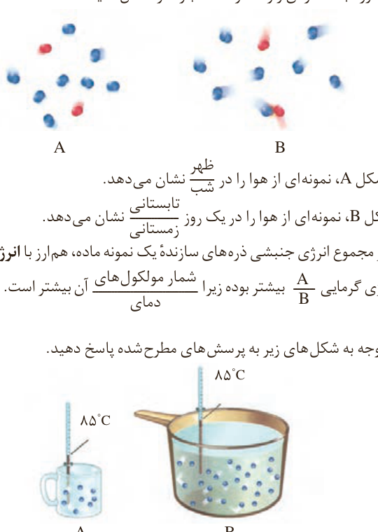

با بررسی این تجربه اینک می‌پذیرید که در دمای معین یک ویژگی مشترک مواد با هر حالت فیزیکی، وجود جنبش‌های نامنظم ذره‌های سازنده آنها است. هر چه دمای ماده بالاتر باشد، میانگین تندی¹ و میانگین انرژی جنبشی² ذره‌های سازنده آن بیشتر است. به دیگر سخن دمای یک ماده، معیاری برای توصیف میانگین تندی و میانگین انرژی جنبشی ذره‌های سازنده آن است.

## با هم بیندیشیم

۱- شکل زیر دو نمونه از هوای صاف شهر شما را با جرم یکسان نشان می‌دهد. با توجه به آن در هر مورد با خط زدن واژه نادرست، عبارت را کامل کنید.

الف) شکل A، نمونه‌ای از هوا را در (ظهر / شب) نشان می‌دهد.

ب) شکل B، نمونه‌ای از هوا را در یک روز (تابستانی / زمستانی) نشان می‌دهد.

پ) اگر مجموع انرژی جنبشی ذره‌های سازنده یک نمونه ماده، هم‌ارز با انرژی گرمایی³ آن باشد، انرژی گرمایی (A / B) بیشتر بوده زیرا (شمار مولکول‌های / دمای) آن بیشتر است.

۲- با توجه به شکل‌های زیر به پرسش‌های مطرح شده پاسخ دهید.

الف) میانگین تندی مولکول‌های آب را در دو ظرف مقایسه کنید.

ب) انرژی گرمایی آب موجود در کدام ظرف بیشتر است؟ چرا؟

هر جسم m که با تندی v حرکت می‌کند، دارای انرژی جنبشی $\frac12mv^2$ است. یکای رایج دما، درجه سلسیوس (°C)، در حالی که یکای دما در SI کلوین (K) است. نماد دما بر حسب سلسیوس $\theta$ و نماد دما بر حسب کلوین $T$ است.

۱- Speed  
۲- Kinetic Energy  
۳- Thermal Energy
