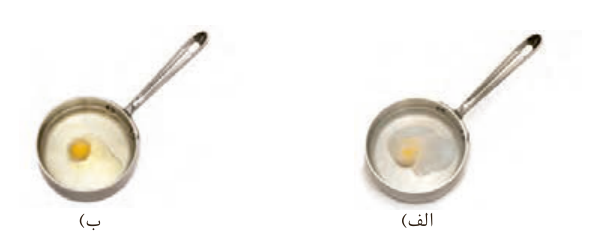

شکل ۲- تخم‌مرغ درون آب (الف) و روغن زیتون (ب) با دمای ۷۵ °C

تخم‌مرغ در این دما درون آب پخته می‌شود اما درون روغن زیتون تغییر محسوسی نخواهد کرد. آیا می‌دانید علت این پدیده چیست؟

گرما را با نماد «Q» نشان می‌دهند و یکای اندازه‌گیری آن در SI، «ژول» (J) است. $1J=1kg\,m^2s^{-2}$

هنوز در برخی موارد از یکای کالری (cal) برای بیان مقدار گرما استفاده می‌شود. $1cal=4/18J$

## با هم بیندیشیم

با توجه به شکل‌های داده شده، به پرسش‌های زیر پاسخ دهید.

۲۰۰ g آب (۲۵ °C) $\xrightarrow{41800J}$ ۲۰۰ g آب (۷۵ °C)

۲۰۰ g روغن زیتون (۲۵ °C) $\xrightarrow{19700J}$ ۲۰۰ g روغن زیتون (۷۵ °C)

الف) توضیح دهید چرا تخم‌مرغ در آب می‌پزد اما در روغن زیتون تغییر محسوسی نمی‌کند؟

ب) می‌دانید که **ظرفیت گرمایی**¹ (C) ماده هم‌ارز با گرمای لازم برای افزایش دمای آن به اندازه یک درجه سلسیوس است. با این توصیف ظرفیت گرمایی آب و روغن زیتون را محاسبه و با یکدیگر مقایسه کنید.

پ) ظرفیت گرمایی ماده به چه عواملی بستگی دارد؟

ت) در فیزیک دهم آموختید که ظرفیت گرمایی یک گرم ماده، ظرفیت گرمایی ویژه یا **گرمای ویژه**² (c) آن ماده را نشان می‌دهد، مقدار این کمیت را برای آب و روغن زیتون حساب و باهم مقایسه کنید.

ث) رابطه‌ای میان ظرفیت گرمایی و گرمای ویژه یک ماده بیابید.

اینک می‌توان پختن تخم‌مرغ در آب ۷۵ °C در مقایسه با روغن زیتون در همین دما را توضیح داد. با اینکه جرم هر دو مایع در این آزمایش برابر است اما آب به دلیل داشتن ظرفیت گرمایی

۱- Heat Capacity
۲- Specific Heat
