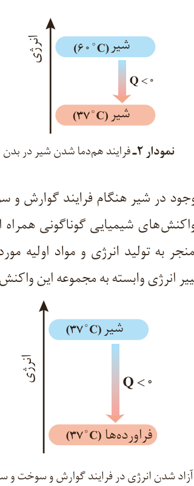

مقداری انرژی به شکل گرما از دست می‌دهد تا با بدن هم‌دما شود. شیمی‌دان‌ها برای درک آسان‌تر جاری شدن انرژی گرمایی در فرایندهایی از این دست، شیر گرم را **سامانه**¹ و بدن را **محیط**² پیرامون آن در نظر می‌گیرند، با این توصیف در این فرایند با جاری شدن انرژی از سامانه به محیط، دمای سامانه کاهش می‌یابد ($\Delta\theta<0$). این ویژگی نشان می‌دهد که $Q<0$ بوده و با فرایندی **گرماده**³ سر و کار داریم. الگوی نوشتاری این فرایند به صورت زیر است:

شیر (۶۰ °C) ← شیر (۳۷ °C) + گرما

انجام این فرایند را از دیدگاه انرژی می‌توان با نمودار ۲ نشان داد.

نمودار ۲- فرایند هم‌دما شدن شیر در بدن: شیر (۶۰ °C)، $Q<0$، شیر (۳۷ °C).

اما بخش عمده انرژی موجود در شیر هنگام فرایند گوارش و سوخت‌وساز به بدن می‌رسد. فرایندهایی که با انجام واکنش‌های شیمیایی گوناگونی همراه است. به دیگر سخن، انجام مجموعه این واکنش‌ها منجر به تولید انرژی و مواد اولیه مورد نیاز سوخت‌وساز یاخته‌ها خواهد شد. نمودار ۳، تغییر انرژی وابسته به مجموعه این واکنش‌ها را نشان می‌دهد.

نمودار ۳- آزاد شدن انرژی در فرایند گوارش و سوخت و ساز شیر در بدن: شیر (۳۷ °C)، $Q<0$، فرآورده‌ها (۳۷ °C).

در این واکنش‌ها با اینکه دما ثابت است (۳۷ °C)، اما باز هم میان سامانه و محیط پیرامون، انرژی دادوستد می‌شود.

شیر اشرف نوشیدنی‌ها، غذایی که مصرف آن برای همگان مفید است.

بستنی یک خوراکی دوست‌داشتنی، خنک و سرشار از مواد مغذی و انرژی‌زاست. فرایند هم‌دما شدن آن در بدن با جذب انرژی، در حالی که گوارش و سوخت و ساز آن با آزاد شدن انرژی همراه است.

۱- System
۲- Surroundings
۳- Exothermic
