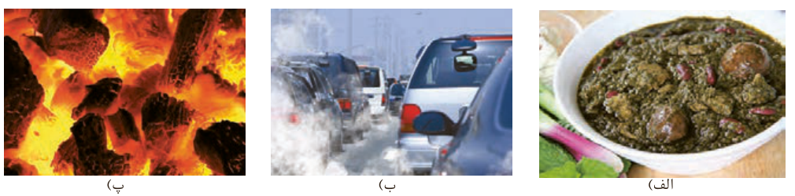
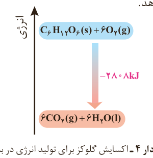

## گرما در واکنش‌های شیمیایی (گرماشیمی)

می‌دانید که هر واکنش شیمیایی ممکن است با تغییر رنگ، تولید رسوب، آزاد شدن گاز و ایجاد نور و صدا همراه باشد اما یک ویژگی بنیادی در همه آنها داد و ستد گرما با محیط پیرامون است. از این رو هر واکنش شیمیایی می‌تواند گرماده یا گرماگیر باشد. بررسی و مطالعه این ویژگی در واکنش‌ها، منجر به پیدایش ترموشیمی (گرماشیمی) شد؛ شاخه‌ای از علم شیمی که به بررسی کمی و کیفی گرمای واکنش‌های شیمیایی، تغییر آن و تأثیری که بر حالت ماده دارد، می‌پردازد. از آنجا که روزانه واکنش‌های شیمیایی بسیاری در اطراف ما و حتی درون بدن ما رخ می‌دهد، می‌توان به وسعت قلمرو ترموشیمی پی برد؛ شما نیز با کمی دقت درمی‌یابید که امروزه گرماشیمی نقش و اهمیت بسیاری در زندگی دارد. شکل ۳ نمونه‌هایی از آنها را نشان می‌دهد.

شکل ۳- الف) مواد غذایی پس از گوارش، انرژی لازم برای سوخت‌وساز یاخته‌ها را در بدن تأمین می‌کنند.  
ب) سوختن سوخت‌ها، انرژی لازم برای حمل و نقل و نیز گرمایش محیط‌های گوناگون را فراهم می‌کنند.  
پ) زغال کک، واکنش‌دهنده‌ای رایج در استخراج آهن و تأمین‌کننده انرژی لازم برای انجام واکنش است.

منبع انرژی در بدن غذا است. منبعی که انرژی آن پس از انجام واکنش‌های شیمیایی گوناگون به بدن می‌رسد. بدیهی است که هر یک از این واکنش‌ها می‌تواند گرماده یا گرماگیر باشد؛ واکنش‌هایی که برای انجام شدن باید گرما از دست بدهند یا جذب کنند. نمودار ۴ یکی از این واکنش‌ها را نشان می‌دهد.

نمودار ۴- اکسایش گلوکز برای تولید انرژی در بدن

$\mathrm{C_6H_{12}O_6(s)+6O_2(g)\longrightarrow 6CO_2(g)+6H_2O(l)}$، $-2808\,\mathrm{kJ}$

جالب اینکه با وجود تولید انرژی در واکنش اکسایش گلوکز، دمای بدن تغییر محسوسی

## آیا می‌دانید

**شیمی‌فیزیک**¹، شاخه‌ای از علم شیمی است که این علم تجربی را بر مبنای مفاهیم فیزیکی و زبان ریاضی بنا نهاده و گسترش می‌دهد. این شاخه همه شیمی را به یکدیگر مرتبط می‌کند به طوری که با اصول علمی آن می‌توان ساختار و تغییر ماده را درک کرد. سینتیک شیمیایی، طیف‌سنجی، الکتروشیمی و ... از جمله مباحث آن است.

۱- Physical Chemistry
