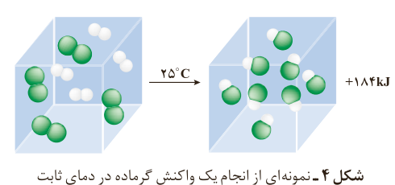

نمی‌کند، گویی دمای بدن در سراسر زمان انجام این واکنش ثابت می‌ماند (فرایند هم‌دما، $\Delta\theta=0$) و این واکنش در دمای ثابت (دمای بدن) انجام می‌شود، اما چرا با وجود دادوستد گرما میان سامانه واکنش و محیط پیرامون، دما ثابت می‌ماند؟

برای پاسخ به این پرسش، یک واکنش میان **مولکول‌های دو اتمی**³ را بررسی می‌کنیم. سامانه‌ای محتوی یک مول گاز هیدروژن و یک مول گاز کلر را با دمای ۲۵ °C در نظر بگیرید. با انجام واکنش میان آنها افزون بر گاز هیدروژن کلرید، گرمای زیادی نیز تولید می‌شود. آزمایش نشان می‌دهد هنگامی که دمای سامانه پس از انجام واکنش به ۲۵ °C می‌رسد، گرمای اندازه‌گیری شده پس از تولید دو مول گاز هیدروژن کلرید برابر با ۱۸۴ kJ است (شکل ۴).

شکل ۴- نمونه‌ای از انجام یک واکنش گرماده در دمای ثابت

پژوهش‌ها نشان می‌دهد که این مقدار گرمای آزادشده ناشی از تفاوت انرژی گرمایی (مجموع انرژی جنبشی ذره‌ها) در مواد واکنش‌دهنده و فرآورده نیست! زیرا در دمای ثابت، تفاوت چشمگیری میان انرژی گرمایی آنها وجود ندارد. شیمی‌دان‌ها گرمای جذب یا آزادشده در هر واکنش شیمیایی را به طور عمده وابسته به تفاوت میان انرژی پتانسیل مواد واکنش‌دهنده و فرآورده می‌دانند. با این توصیف، انرژی پتانسیل یک نمونه ماده، انرژی نهفته‌شده در آن است، انرژی‌ای که ناشی از نیروهای نگهدارنده ذره‌های سازنده آن است.

برای درک این مفهوم، به ساختار مولکول‌های گازی مواد شرکت‌کننده در واکنش یادشده توجه کنید.

$\mathrm{H-H(g)+Cl-Cl(g)\rightarrow 2H-Cl(g)}$

در هر مولکول از این مواد، تنها دو اتم با یک پیوند اشتراکی به یکدیگر متصل‌اند، اما نوع اتم‌های متصل به هم در هر مولکول متفاوت از دیگری است؛ به دیگر سخن نیروهای نگهدارنده اتم در هر مولکول و در نتیجه استحکام پیوندها از یکدیگر متفاوت خواهد بود.

این الگو نشان می‌دهد که با انجام یک واکنش شیمیایی و تغییر در شیوه اتصال اتم‌ها به یکدیگر، تفاوت آشکاری در انرژی پتانسیل وابسته به آنها ایجاد می‌شود؛ تفاوت در انرژی که در واکنش‌ها به شکل گرما ظاهر می‌شود.

در برخی منابع از **انرژی پتانسیل**¹ موجود در یک نمونه ماده، با نام **انرژی شیمیایی**² یاد می‌شود.

## آیا می‌دانید

افتادن سیب از درخت بر روی زمین نتیجه نیروی گرانش بوده و نشانه‌ای از وجود پتانسیل گرانشی است در حالی که رسانایی الکتریکی محلول الکترولیت نتیجه نیروی جاذبه میان یون‌ها و قطب‌های ناهمنام بوده و نشانه‌ای از وجود پتانسیل الکتریکی است. در واقع پتانسیل‌ها نتیجه‌ای از برهم‌کنش‌های گوناگون هستند.

۱- Potential Energy
۲- Chemical Energy
۳- Diatomic Molecules
