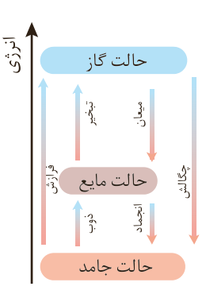

## با هم بیندیشیم

۱- با توجه به واکنش‌های زیر پاسخ دهید:

$\mathrm{N_2(g)+3H_2(g)\xrightarrow{25^\circ C}2NH_3(g)+92kJ}$

$\mathrm{N_2H_4(g)+H_2(g)\xrightarrow{25^\circ C}2NH_3(g)+183kJ}$

الف) چرا گرمای آزاد شده در دو واکنش متفاوت است؟ توضیح دهید.

ب) در کدام واکنش، مواد واکنش‌دهنده پایدارتر است؟ چرا؟

۲- گرافیت و الماس دو آلوتروپ کربن هستند که فرآورده واکنش سوختن کامل آنها، گاز کربن دی‌اکسید است.

$\mathrm{C(s,\ گرافیت)+O_2(g)\longrightarrow CO_2(g)+393/5\ kJ}$

$\mathrm{C(s,\ الماس)+O_2(g)\longrightarrow CO_2(g)+395/4\ kJ}$

الف) چرا گرمای حاصل از سوختن یک مول گرافیت متفاوت از یک مول الماس است؟

ب) الماس پایدارتر است یا گرافیت؟ چرا؟

پ) از سوختن کامل ۷/۲ g گرافیت، چند کیلوژول گرما آزاد می‌شود؟

۳- با توجه به واکنش $\mathrm{2H_2(g)+O_2(g)\rightarrow 2H_2O(g)+484kJ}$، پیش‌بینی کنید گرمای واکنش $\mathrm{2H_2(g)+O_2(g)\rightarrow 2H_2O(l)}$ کدام است؟ ($-572\,kJ$، $+572\,kJ$، $-396\,kJ$، $+396\,kJ$) چرا؟

دریافتید که گرمای یک واکنش در دما و فشار ثابت، به نوع و مقدار واکنش‌دهنده‌ها، نوع فرآورده‌ها و حالت فیزیکی آنها بستگی دارد. کمیتی که یکی از ویژگی‌های کاربردی و بنیادی هر واکنش به شمار می‌رود.

## پیوند با زندگی

بسیاری از مردم کشور نیجریه در مناطق خشک، بیابانی و بادخیز زندگی می‌کنند. مناطقی که تهیه غذا در آنها دشوار اما نگهداری آن دشوارتر است. محمد باه آبا، معلم نیجریایی با طراحی و ساخت دستگاهی ساده و ارزان به مردم کشورش خدمتی ارزنده ارائه کرد. دستگاهی که همانند یک یخچال اما بدون نیاز به انرژی الکتریکی، غذا را خنک و برای مدت طولانی‌تری

## آیا می‌دانید

$\mathrm{N_2H_4}$، هیدرازین نامیده می‌شود، ماده‌ای پرانرژی که به عنوان سوخت موشک استفاده می‌شود.

در شیمی ۱ آموختید که اتم‌ها در حالت پایه با جذب انرژی به اتم‌های برانگیخته تبدیل می‌شوند. اتم‌های برانگیخته، پرانرژی‌تر و ناپایدارترند.

الماس و گرافیت، دو آلوتروپ کربن

تغییر حالت فیزیکی مواد خالص با تغییر انرژی همراه است: حالت جامد، ذوب، حالت مایع، تبخیر، حالت گاز؛ انجماد، میعان؛ فرازش و چگالش.
