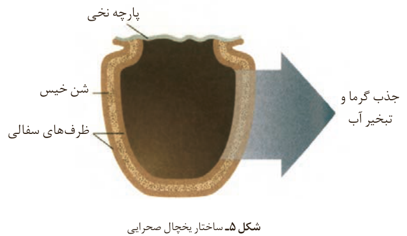

نگه می‌دارد (شکل ۵).

شکل ۵- ساختار یخچال صحرایی: پارچه نخی، شن خیس، ظرف‌های سفالی، جذب گرما و تبخیر آب.

مطابق شکل ۵، او برای ساخت این دستگاه، دو ظرف سفالی (ساخته شده از خاک رس) را درون یکدیگر قرار داد و فضای میان آنها را با شن خیس پر کرد. درپوش این مجموعه، پوششی نخی و مرطوب است که تهویه را به آسانی انجام می‌دهد. آب در بدنه سفالی ظرف بیرونی نفوذ کرده و به آرامی تبخیر می‌شود، معادله انجام این فرایند به صورت زیر است:

$\mathrm{H_2O(l)+44/1\ kJ\rightarrow H_2O(g)}$

این معادله نشان می‌دهد که برای تبخیر یک مول آب به ۴۴/۱ کیلوژول گرما نیاز است. جذب گرما در این فرایند باعث افت دما شده و فضای درونی دستگاه همراه با محتویات آن را خنک می‌کند؛ شرایطی که برای سالم نگه‌داشتن غذا به مدت طولانی‌تر مناسب است.

آیا تاکنون آبی گوارا و خنک از کوزه نوشیده‌اید؟ کوزه، ظرفی سفالی است که ایرانیان از گذشته‌های دور برای نگهداری آب آشامیدنی از آن استفاده می‌کردند. این سفالینه نیز از خاک رس تهیه می‌شود و در بدنه خود روزنه‌های بسیار ریزی دارد. هنگامی که کوزه حاوی آب باشد، آب به آسانی به دیواره آن نفوذ کرده تا جایی که حتی سطح بیرونی آن را نیز نمناک می‌کند. در این شرایط، به‌تدریج آب از سطح بیرونی کوزه تبخیر شده و گرمای لازم برای این فرایند از محتویات کوزه تأمین می‌شود. فرایندی که باعث کاهش دما و خنک‌شدن آب خواهد شد.

## آنتالپی¹، همان محتوای انرژی است؟

هر نمونه ماده شامل مجموعه‌ای از شمار بسیار زیادی ذره‌های سازنده است. این ذره‌ها افزون بر جنبش‌های نامنظم، با یکدیگر برهم‌کنش نیز دارند. در واقع، ذره‌های سازنده یک نمونه ماده افزون بر انرژی جنبشی، دارای انرژی پتانسیل نیز هستند. می‌دانید که یک نمونه ماده با مقدار آن در دما و فشار معین توصیف می‌شود، به‌طوری که ۲۰۰ گرم آب در دما و فشار اتاق را می‌توان یک نمونه ماده دانست. اینک ظرفی را در نظر بگیرید که محتوی این نمونه ماده باشد، چنین مجموعه‌ای یک سامانه به شمار می‌رود.

۱- Enthalpy
