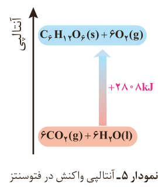

شیمی‌دان‌ها انرژی کل چنین سامانه‌ای را هم‌ارز با محتوای انرژی یا آنتالپی آن می‌دانند. با این توصیف هر سامانه در دما و فشار ثابت، آنتالپی معینی دارد. بدیهی است که با انجام واکنش شیمیایی گرماگیر در یک سامانه، مواد با محتوای انرژی (آنتالپی) کمتر به موادی با انرژی (آنتالپی) بیشتر تبدیل می‌شوند (نمودار ۵).

نمودار ۵- آنتالپی واکنش در فتوسنتز: $\mathrm{6CO_2(g)+6H_2O(l)\rightarrow C_6H_{12}O_6(s)+6O_2(g)}$، $+2808\,kJ$.

انجام این واکنش، برخلاف اکسایش گلوکز با جذب انرژی همراه است. از آنجا که داد و ستد انرژی در واکنش‌ها به‌طور عمده به شکل گرما ظاهر می‌شود، شیمی‌دان‌ها تغییر آنتالپی هر واکنش را هم‌ارز با گرمایی می‌دانند که در فشار ثابت با محیط پیرامون دادوستد می‌کند و آن را با $Q_p$ نشان می‌دهند.

نماد آنتالپی، «H» است در حالی که نماد تغییر آنتالپی، «ΔH» می‌باشد؛ کمیتی که با رابطه زیر بیان می‌شود:

$\Delta H(\text{واکنش})=H(\text{مواد فرآورده})-H(\text{مواد واکنش‌دهنده})=Q_p$

## خود را بیازمایید

۱- نماد Q را در هر معادله وارد کرده سپس علامت «ΔH» را در هر مورد مشخص کنید.

الف) $\mathrm{CO_2(s)\rightarrow CO_2(g)}$

ب) $\mathrm{CH_4(g)+2O_2(g)\rightarrow CO_2(g)+2H_2O(g)}$

همه مواد پیرامون ما در دما و فشار اتاق، آنتالپی معینی دارند.

در بسیاری از منابع علمی معتبر از آنتالپی با نام **محتوای گرمایی** یاد می‌شود.

برای یک واکنش اغلب به جای تغییر آنتالپی واکنش، واژه آنتالپی واکنش به کار می‌رود.

مقدار عددی «ΔH» یک فرایند بزرگی آن را نشان می‌دهد، در حالی که علامت مثبت و منفی تنها نشان‌دهنده گرماگیر و گرماده بودن آن است.
