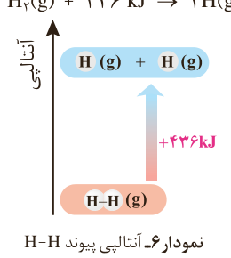

پ) $\mathrm{N_2O_4(g)\rightarrow 2NO_2(g)}$

ت) $\mathrm{H_2O(l)\rightarrow H_2O(s)}$

۲- اگر برای تولید یک مول گاز اوزون از گاز اکسیژن، آنتالپی به اندازه ۱۴۳ kJ افزایش یابد، آنتالپی واکنش $\mathrm{3O_2(g)\rightleftharpoons 2O_3(g)}$ را در جهت رفت و در جهت برگشت حساب کنید.

## آنتالپی پیوند و میانگین آن

انجام یک واکنش شیمیایی نشانه‌ای از تغییر در شیوه اتصال اتم‌ها به یکدیگر است که به تغییر در ساختار و خواص مواد منجر می‌شود. یکی از خواصی که در واکنش‌های شیمیایی تغییر می‌کند، محتوای انرژی مواد است. این توصیف از واکنش، اهمیت پیوندهای شیمیایی و نقش انرژی وابسته به آنها را در گرمای یک واکنش نشان می‌دهد. برای درک انرژی پیوند می‌توان بحث را با پیوند میان ساده‌ترین اتم‌ها ادامه داد.

یک نمونه گاز هیدروژن، مجموعه‌ای از شمار بسیار زیادی مولکول‌های دواتمی بوده و هر مولکول شامل دو اتم هیدروژن با یک پیوند اشتراکی است. انتظار می‌رود برای تبدیل این مولکول‌ها به اتم‌های جدا از هم انرژی صرف شود. شواهد تجربی نشان می‌دهد که انرژی لازم برای شکستن پیوندهای اشتراکی موجود در یک مول $\mathrm{H_2(g)}$ و تبدیل آن به دو مول $\mathrm{H(g)}$، حدود ۴۳۶ kJ است (نمودار ۶).

$\mathrm{H_2(g)+436\ kJ\rightarrow 2H(g)}$

نمودار ۶- آنتالپی پیوند H–H

## آیا می‌دانید

در هوای سرد زمستان برای گرم نگه‌داشتن دست‌ها می‌توان از کیسه‌های گرم‌زا استفاده کرد. این کیسه‌ها حاوی مواد شیمیایی هستند که در اثر مخلوط شدن با یکدیگر واکنش می‌دهند و گرما آزاد می‌شود. در برخی از این کیسه‌ها از واکنش اکسایش آهن برای تولید گرما استفاده می‌شود.

$\mathrm{4Fe(s)+3O_2(g)\rightarrow 2Fe_2O_3(s)}$

دمای محتویات کیسه پیش از انجام واکنش شیمیایی؛ دمای محتویات کیسه پس از انجام واکنش شیمیایی.

**جدول ۲- آنتالپی برخی پیوندها**

| پیوند | آنتالپی ($kJ\,mol^{-1}$) |
|---|---|
| Cl–Cl | ۲۴۲ |
| Br–Br | ۱۹۳ |
| I–I | ۱۵۱ |
| H–F | ۵۶۷ |
| H–Cl | ۴۳۱ |
| O=O | ۴۹۵ |
| N≡N | ۹۴۵ |
