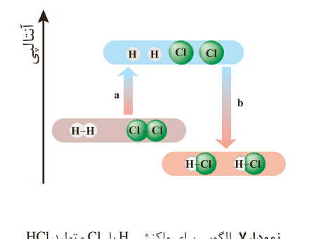
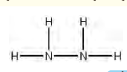

نمودار ۷- الگویی برای واکنش $\mathrm{H_2}$ با $\mathrm{Cl_2}$ و تولید HCl

کمیت a در نمودار ۷، انرژی لازم برای شکستن پیوندهای اشتراکی H–H و Cl–Cl را در یک مول از هر کدام آنها نشان می‌دهد، به‌طوری که این مقدار انرژی هم‌ارز با مجموع آنتالپی این پیوندهاست:

$a=(1\,mol\times 436\,kJ\,mol^{-1})+(1\,mol\times 242\,kJ\,mol^{-1})=678\,kJ$

کمیت b در این نمودار، انرژی حاصل از تشکیل پیوندهای اشتراکی H–Cl را در دو مول از آن نشان می‌دهد، از این رو کمیت b هم‌ارز با دو برابر آنتالپی این پیوند اما با علامت منفی است:

$b=-(2\,mol\times 431\,kJ\,mol^{-1})=-862\,kJ$

اینک از جمع جبری کمیت‌های a و b، آنتالپی واکنش به دست می‌آید:

$\Delta H(\text{واکنش})=a+b=678\,kJ+(-862\,kJ)=-184\,kJ$

شیمی‌دان‌ها به کار بردن آنتالپی‌های پیوند را برای تعیین ΔH واکنش‌هایی مناسب می‌دانند که همه مواد شرکت‌کننده در آنها به حالت گازند. در چنین واکنش‌هایی هرچه مولکول‌های مواد شرکت‌کننده ساده‌تر باشند، آنتالپی واکنش محاسبه شده با داده‌های تجربی همخوانی بیشتری دارد. به دیگر سخن به کار بردن میانگین آنتالپی پیوندها برای تعیین ΔH واکنش‌های گازی با مولکول‌های پیچیده‌تر اغلب در مقایسه با داده‌های تجربی، تفاوتی آشکار نشان می‌دهد.

## خود را بیازمایید

۱- دانش‌آموزی، برای تعیین آنتالپی یک واکنش گازی از رابطه زیر استفاده کرده است، درستی این رابطه را بررسی کنید.

$\Delta H(\text{واکنش})=[\text{مجموع آنتالپی پیوندها در مواد واکنش‌دهنده}]-[\text{مجموع آنتالپی پیوندها در مواد فرآورده}]$

در ارزشیابی‌های پایانی، نهایی و آزمون‌های سراسری در این گونه پرسش‌ها باید فرمول ساختاری مواد شرکت‌کننده داده شود.

