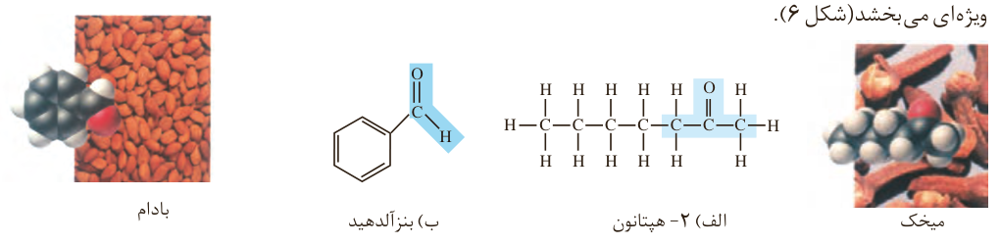
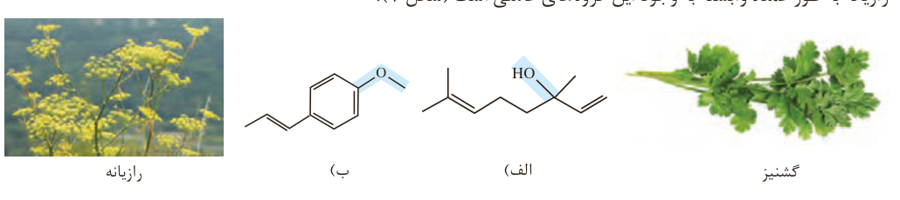
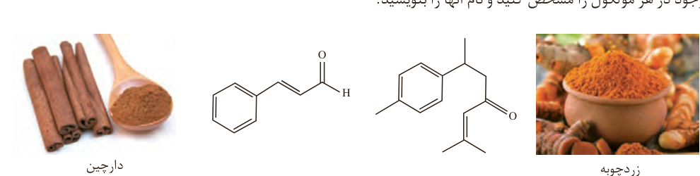

ویژه‌ای می‌بخشد (شکل ۶).

شکل ۶- نمایش گروه عاملی کربونیل در ۲-هپتانون و بنزآلدهید. چه تفاوتی میان گروه کربونیل آلدهیدی و کتونی وجود دارد؟

اما در ساختار برخی ادویه‌ها گروه‌های عاملی دیگری نیز وجود دارد. گروه‌هایی که در آنها اتم اکسیژن به یک یا دو اتم کربن با پیوند یگانه متصل است. این گروه‌های عاملی به ترتیب **هیدروکسیل**¹ ($\mathrm{-O-H}$) و گروه اتری ($\mathrm{-O-}$) نام دارند. برای نمونه طعم و بوی گشنیز و رازیانه به طور عمده وابسته به وجود این گروه‌های عاملی است (شکل ۷).

شکل ۷- نمونه‌ای از ترکیب‌های آلی موجود در (الف) گشنیز و (ب) رازیانه

## خود را بیازمایید

۱- هر ساختار زیر یک ترکیب آلی موجود در آن ادویه را نشان می‌دهد. گروه‌های عاملی موجود در هر مولکول را مشخص کنید و نام آنها را بنویسید.

۱- Hydroxyl
