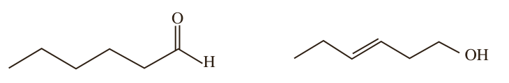

۲- با توجه به ساختار ترکیب‌های آلی زیر به پرسش‌های مطرح شده پاسخ دهید.

الف) شمار و نوع اتم‌های سازنده آنها را با یکدیگر مقایسه کنید.

ب) آیا خواص فیزیکی و شیمیایی آنها یکسان است؟ چرا؟

پ) آیا محتوای انرژی آنها را یکسان پیش‌بینی می‌کنید؟ توضیح دهید.

شیمی‌دان‌ها به موادی که فرمول مولکولی یکسان اما ساختار متفاوتی دارند، ایزومر (همپار) می‌گویند.

## آنتالپی سوختن، تکیه‌گاهی برای تأمین انرژی

کباب کردن انواع گوشت، نمونه‌ای کاربردی و خوشایند از ترموشیمی به ویژه آنتالپی سوختن در زندگی است. انرژی لازم برای پختن گوشت در این فرایند از سوختن زغال یا گاز شهری فراهم می‌شود و از سوی دیگر خوردن کباب، مواد و انرژی لازم برای انجام فعالیت‌های بدن را تأمین می‌کند.

این دیدگاه شیمیایی در تهیه غذا کمک می‌کند تا افزون بر درک و تعیین آنتالپی واکنش سوختن مواد، به ارزش غذایی انواع خوراکی‌ها نیز توجه شود.

بدن ما از غذا، مواد گوناگونی دریافت می‌کند. این مواد شامل کربوهیدرات‌ها، چربی‌ها، پروتئین‌ها، آب، ویتامین‌ها و مواد معدنی بوده که سه ماده نخست، افزون بر تأمین مواد اولیه برای سوخت‌وساز یاخته‌ها، منابعی برای تأمین انرژی آنها نیز هستند. در این میان تنها کربوهیدرات‌ها هستند که در بدن به گلوکز شکسته شده و گلوکز حاصل از آنها در خون حل می‌شود. خون این ماده را به یاخته‌ها می‌رساند (گلوکز، قند خون است) و این ماده هنگام اکسایش در یاخته‌ها، انرژی تولید می‌کند؛ این روند به آسانی انرژی مورد نیاز یاخته‌ها را تأمین می‌کند. اما پرسش این است که چرا بدن ما، چربی را بیشتر ذخیره می‌کند؟

پژوهش‌ها نشان می‌دهد که چربی ارزش سوختی بیشتری از کربوهیدرات‌ها و پروتئین‌ها نیز دارد. به دیگر سخن، انرژی حاصل از اکسایش یک گرم چربی بیشتر از دو ماده غذایی دیگر است (جدول ۴).

**جدول ۴- ارزش سوختی سه ماده غذایی**

| ماده غذایی | کربوهیدرات | چربی | پروتئین |
|---|---|---|---|
| ارزش سوختی ($kJ\,g^{-1}$) | ۱۷ | ۳۸ | ۱۷ |

با این الگو می‌توان مقدار انرژی‌ای که با مصرف مقدار معینی از هر غذا به بدن می‌رسد را

هنگام کباب کردن گوشت و خوردن آن نقش و اهمیت ترموشیمی را آشکارتر احساس می‌کنید.

## آیا می‌دانید

واکنش سوختن پروتئین‌ها در آزمایشگاه با واکنش اکسایش آنها در بدن متفاوت است، زیرا پروتئین‌ها مواد آلی نیتروژن‌دارند که از سوختن کامل آنها افزون بر $\mathrm{CO_2}$، $\mathrm{H_2O}$ و انرژی، گاز $\mathrm{N_2}$ نیز تولید می‌شود؛ اما از اکسایش آنها در بدن، نیتروژن به طور عمده به شکل اوره درمی‌آید.

با اینکه همه واکنش‌های سوختن گرماده است؛ اما ارزش سوختی در منابع معتبر علمی بدون علامت منفی گزارش شده است.

هر کیلوگرم از بدن به‌طور میانگین به ۱۰۰ کیلوژول انرژی در شبانه‌روز نیاز دارد تا وظایف خود را در پایین‌ترین سطح انجام دهد. این در حالی است که آهنگ مصرف انرژی در یک فرد ۷۰ کیلوگرمی هنگام فعالیت سبک مانند باغبانی یا پیاده‌روی حدود ۸۰۰ کیلوژول و هنگام دویدن حدود ۲۰۰۰ کیلوژول در هر ساعت است.
