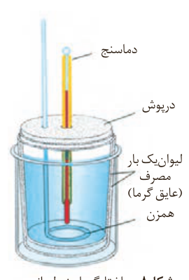

ب) جرم $\mathrm{CO_2}$ حاصل از سوختن یک گرم از هریک را محاسبه و با یکدیگر مقایسه کنید.

پ) توضیح دهید چرا اتانول **سوخت سبز**¹ به شمار می‌رود؟

سوخت‌های سبز در ساختار خود افزون بر هیدروژن و کربن، اکسیژن نیز دارند و از پسماندهای گیاهانی مانند سویا، نیشکر و دیگر دانه‌های روغنی استخراج می‌شوند.

## در میان تارنماها

با مراجعه به منابع علمی معتبر گزارشی از مواد انرژی‌زا یا نیروزا در ورزش‌های قهرمانی و آثار زیان‌بار آنها بر بدن تهیه و در کلاس ارائه کنید.

## جمع‌پذیری گرمای واکنش‌ها، قانون هس²

آنتالپی بسیاری از واکنش‌های شیمیایی را نمی‌توان به روش تجربی (شکل ۸) اندازه‌گیری کرد، زیرا برخی از آنها مرحله‌ای از یک واکنش پیچیده هستند و برخی دیگر به آسانی انجام نمی‌شوند. آشکار است که تأمین شرایط بهینه برای انجام آنها بسیار دشوار است. شیمی‌دان‌ها برای تعیین ΔH چنین واکنش‌هایی از روش‌های دقیق دیگری همانند قانون هس بهره می‌برند.

می‌دانید که متان، ساده‌ترین هیدروکربن و نخستین عضو خانواده آلکان‌ها است و بخش عمده گاز طبیعی را تشکیل می‌دهد. این گاز از تجزیه گیاهان به‌وسیله باکتری‌های بی‌هوازی نیز در زیر آب تولید می‌شود (شکل ۹). شاید تصور کنید که گاز متان را می‌توان مطابق معادله زیر از واکنش میان گرافیت و گاز هیدروژن در آزمایشگاه تهیه کرد:

$\mathrm{C(s,\ گرافیت)+2H_2(g)\longrightarrow CH_4(g)}$، $\Delta H=?$

آزمایش‌ها و یافته‌های تجربی نشان می‌دهند که تأمین شرایط بهینه برای انجام این واکنش بسیار دشوار و پرهزینه است، به همین دلیل برای تعیین ΔH این واکنش می‌توان از واکنش‌های دیگری بهره برد که ΔH آنها پیش از این تعیین شده است. این واکنش‌های ترموشیمیایی می‌توانند واکنش سوختن یک مول گرافیت، یک مول گاز هیدروژن و یک مول گاز متان باشند که معادله هریک از آنها در ۲۵ °C به‌صورت زیر است:

۱) $\mathrm{C(s,\ گرافیت)+O_2(g)\longrightarrow CO_2(g)}$، $\Delta H_1=-393/5\,kJ$

۲) $\mathrm{H_2(g)+\frac12 O_2(g)\longrightarrow H_2O(l)}$، $\Delta H_2=-286\,kJ$

۳) $\mathrm{CH_4(g)+2O_2(g)\longrightarrow CO_2(g)+2H_2O(l)}$، $\Delta H_3=-890\,kJ$

شکل ۸- ساختار گرماسنج لیوانی. دستگاهی که به کمک آن می‌توان گرمای واکنش را در فشار ثابت به روش تجربی تعیین کرد. این گرماسنج برای تعیین ΔH فرایندهای انحلال و واکنش‌هایی که در حالت محلول انجام می‌شوند، مناسب است.

اگر واکنش شیمیایی با ΔH وابسته به آن بیان شود، به آن **واکنش گرما (ترمو) شیمیایی**³ می‌گویند.

۱- Green Fuel
۲- Hess's Law
۳- Thermochemical Reaction
