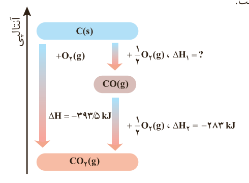

## خود را بیازمایید

۱- هیدروژن پراکسید ($\mathrm{H_2O_2}$) ماده‌ای است که با نام تجاری آب اکسیژنه به فروش می‌رسد.

الف) با استفاده از واکنش‌های زیر، آنتالپی واکنش $\mathrm{H_2(g)+O_2(g)\longrightarrow H_2O_2(l)}$ را حساب کنید.

$\mathrm{H_2(g)+\frac12 O_2(g)\longrightarrow H_2O(l)}$، $\Delta H=-286\,kJ$

$\mathrm{2H_2O_2(l)\longrightarrow 2H_2O(l)+O_2(g)}$، $\Delta H=-196\,kJ$

ب) توضیح دهید چرا تهیه این ماده از واکنش مستقیم گاز هیدروژن با اکسیژن ممکن نیست؟

۲- در شیمی ۱ آموختید که گازهای آلاینده مانند NO و CO از اگزوز خودروها به هواکره وارد می‌شوند. شیمی‌دان‌های هواکره انجام واکنش زیر را برای تبدیل این آلاینده‌ها به گازهایی پایدارتر و با آلایندگی کمتر، طراحی کرده‌اند.

$\mathrm{2CO(g)+2NO(g)\longrightarrow 2CO_2(g)+N_2(g)}$، $\Delta H=?$

آنتالپی واکنش بالا را با استفاده از واکنش‌های ترموشیمیایی زیر حساب کنید.

$\mathrm{CO(g)+\frac12 O_2(g)\longrightarrow CO_2(g)}$، $\Delta H=-283\,kJ$

$\mathrm{N_2(g)+O_2(g)\longrightarrow 2NO(g)}$، $\Delta H=+181\,kJ$

۳- واکنش سوختن کامل گرافیت را می‌توان مجموعه‌ای از دو واکنش پی‌درپی مطابق نمودار زیر دانست.

$\mathrm{C(s)\rightarrow CO_2(g)}$: $+\mathrm{O_2(g)}$، $\Delta H=-393/5\,kJ$

$\mathrm{C(s)\rightarrow CO(g)}$: $+\frac12\mathrm{O_2(g)}$، $\Delta H_1=?$

$\mathrm{CO(g)\rightarrow CO_2(g)}$: $+\frac12\mathrm{O_2(g)}$، $\Delta H_2=-283\,kJ$

الف) شواهد نشان می‌دهد که ΔH واکنش تولید $\mathrm{CO(g)}$ را نمی‌توان به روش تجربی تعیین کرد. درباره علت آن گفت‌وگو کنید.

ب) ΔH واکنش تولید $\mathrm{CO(g)}$ را از گرافیت و گاز اکسیژن حساب کنید.

## آیا می‌دانید

آب اکسیژنه، سفیدکننده و رنگ‌بر است؛ ماده‌ای بی‌خطر برای محیط‌زیست که به‌جای سفیدکننده‌های حاوی کلر معرفی می‌شود. آب اکسیژنه با خاصیت ضد میکروبی، یک ضدعفونی‌کننده است؛ اما هنگام استفاده از محلول‌های آن باید به نکات ایمنی توجه و آنها را رعایت کرد.

برای حذف یا کاهش میزان آلاینده‌های خروجی از موتور خودروها در مسیر خروج گازها، قطعه‌ای به نام مبدل کاتالیستی قرار می‌دهند.
