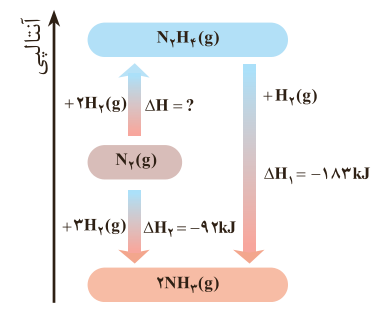
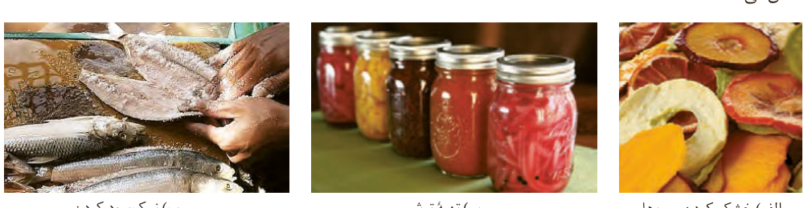

۴- شواهد تجربی نشان می‌دهند که تهیه آمونیاک به روش هابر از گازهای نیتروژن و هیدروژن مطابق نمودار زیر یک واکنش دو مرحله‌ای است.

$\mathrm{N_2(g)+2H_2(g)\rightarrow N_2H_4(g)}$، $\Delta H=?$

$\mathrm{N_2H_4(g)+H_2(g)\rightarrow 2NH_3(g)}$، $\Delta H_1=-183\,kJ$

$\mathrm{N_2(g)+3H_2(g)\rightarrow 2NH_3(g)}$، $\Delta H_2=-92\,kJ$

الف) در شرایط یکسان، هیدرازین پایدارتر است یا آمونیاک؟ چرا؟

ب) آنتالپی واکنش تولید هیدرازین را حساب کنید.

تا اینجا با تغییر محتوای انرژی مواد شرکت‌کننده از جمله سوخت‌ها و مواد غذایی در واکنش‌ها آشنا شدید. اما از دیگر ویژگی‌های مهم یک واکنش، آهنگ انجام آن است؛ کمیتی که در تهیه و نگهداری مواد غذایی سالم نقش کلیدی و تعیین‌کننده دارد.

## غذای سالم

همه خوراکی‌ها و غذاها تاریخ مصرف دارند. آیا تاکنون اندیشیده‌اید که تاریخ مصرف مواد چه معنایی دارد؟ تاریخ مصرف مواد غذایی نشان می‌دهد که چه مدتی سالم می‌ماند و قابل مصرف است. انسان همواره در طول تاریخ در جست‌وجوی روش‌هایی بوده که بتواند ماده غذایی را برای مدت‌های طولانی‌تری سالم نگه دارد و ذخیره کند. شکل ۱۰ برخی روش‌های نگهداری آنها را نشان می‌دهد.

شکل ۱۰- برخی روش‌های افزایش زمان ماندگاری مواد غذایی: (الف) خشک کردن میوه‌ها، (ب) تهیه ترشی، (پ) نمک‌سود کردن.

## آیا می‌دانید

هیدرازین مایعی بی‌رنگ، روغنی با بویی شبیه به آمونیاک، سمی و ناپایدار است. هنگام کار کردن با این ماده رعایت دقیق نکات ایمنی ضروری است؛ به‌طوری که دسترسی به محل کار با هیدرازین محدودیت داشته و تنها افراد متخصص با دانش شیمی و فنی کافی اجازه کار دارند. این ماده افزون بر سوخت موشک، برای حذف اکسیژن در دیگ‌های بخار (جلوگیری از خوردگی) و نیز در تولید فوم‌های پلیمری به کار می‌رود. با پیشرفت دانش و فناوری به نظر می‌رسد این ماده می‌تواند برای تولید انرژی پاک، جایگزین سوخت‌های فسیلی گردد.
