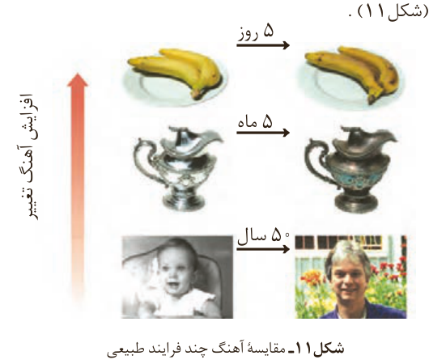

چیست؟ چرا افزایش دما سبب کاهش زمان ماندگاری اغلب مواد غذایی می‌شود؟ اکسیژن چه رفتاری با مواد غذایی دارد؟ چرا مواد غذایی را باید در محلی تاریک و دور از تابش مستقیم نور خورشید نگه‌داشت؟ پاسخ به این پرسش‌ها را می‌توان در رفتار مواد با یکدیگر و اثر عوامل گوناگون روی رفتار آنها جست‌وجو کرد. در واقع سینتیک شیمیایی به عنوان شاخه‌ای از علم شیمی افزون بر بررسی آهنگ تغییر شیمیایی در واکنش‌ها، عوامل مؤثر بر این آهنگ را نیز بررسی می‌کند. با آشنایی و درک چنین مفاهیمی می‌توان روش‌های گوناگون نگهداری سالم مواد غذایی را یافت و آنها را گسترش داد.

## آهنگ واکنش

تهیه و تولید سریع‌تر یا کندتر یک فرآورده صنعتی، دارویی یا غذایی بر کیفیت و زمان ماندگاری آن نقش تعیین‌کننده‌ای دارد. **آهنگ واکنش**¹ معیاری برای زمان ماندگاری مواد است، کمیتی که نشان می‌دهد هر تغییر شیمیایی در چه گستره‌ای از زمان رخ می‌دهد. هرچه گستره زمان انجام آنها کوچک‌تر باشد، آهنگ انجام تندتر است و واکنش سریع‌تر انجام می‌شود (شکل ۱۱).

شکل ۱۱- مقایسه آهنگ چند فرایند طبیعی: موز، ۵ روز؛ ظرف نقره‌ای، ۵ ماه؛ انسان، ۵۰ سال. افزایش آهنگ تغییر.

این شکل فرایندهایی را نشان می‌دهد که تفاوت آهنگ انجام آنها آشکار بوده و مقایسه آنها به‌صورت کیفی آسان است. شیمی‌دان‌ها آهنگ واکنش را در گستره معینی از زمان با نام سرعت واکنش بیان می‌کنند. توجه کنید که گستره زمان انجام واکنش‌ها از چند صدم ثانیه تا چند سده را در برمی‌گیرد (شکل ۱۲).

## آیا می‌دانید

اگر گندم در محیطی سرد و خشک نگهداری شود تا ۲۵ سال کیفیت خود را حفظ می‌کند و سالم می‌ماند؛ درحالی که در محیط گرم و خشک تا ۵ سال سالم می‌ماند! امروزه گندم در مقیاس صنعتی در مکان‌هایی تاریک، خنک و خشک به نام سیلو نگهداری می‌شود. روشی که حضرت یوسف علیه‌السلام از آن بهره برده بود.

۱- Reaction Rate
