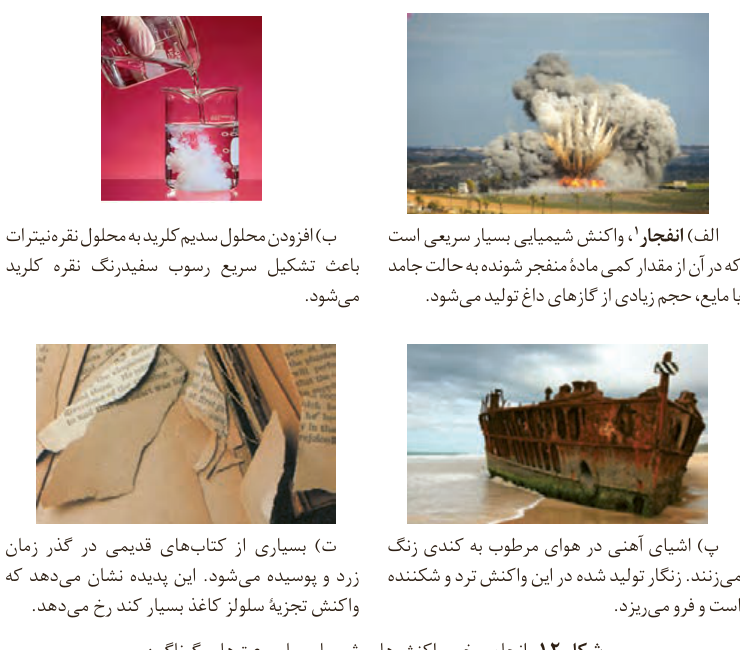

شکل ۱۲- انجام برخی واکنش‌های شیمیایی با سرعت‌های گوناگون

الف) **انفجار**¹، واکنش شیمیایی بسیار سریعی است که در آن از مقدار کمی ماده منفجرشونده به حالت جامد یا مایع، حجم زیادی از گازهای داغ تولید می‌شود.

ب) افزودن محلول سدیم کلرید به محلول نقره نیترات باعث تشکیل سریع رسوب سفیدرنگ نقره کلرید می‌شود.

پ) اشیای آهنی در هوای مرطوب به کندی زنگ می‌زنند. زنگار تولید شده در این واکنش ترد و شکننده است و فرو می‌ریزد.

ت) بسیاری از کتاب‌های قدیمی در گذر زمان زرد و پوسیده می‌شود. این پدیده نشان می‌دهد که واکنش تجزیه سلولز کاغذ بسیار کند رخ می‌دهد.

بررسی‌ها نشان می‌دهد که زمان انجام واکنش‌ها به عوامل گوناگونی وابسته است. به گونه‌ای که برای کاهش یا افزایش سرعت انجام واکنش‌ها می‌توان عواملی مانند دما، غلظت، نوع مواد واکنش‌دهنده، کاتالیزگر و سطح تماس واکنش‌دهنده‌ها را تغییر داد.

## کاوش کنید

درباره «**عوامل مؤثر بر سرعت واکنش**» کاوش کنید.

**مواد و ابزار لازم:** عینک ایمنی، قرص جوشان، آب، قوطی فیلم عکاسی، استوانه مدرج، هاون چینی، دماسنج و زمان‌سنج.

**نکات ایمنی:** به دلیل پرتاب شدن قوطی فیلم عکاسی، آزمایش را در فاصله مناسبی از خود و هم‌کلاسی‌ها انجام دهید.

## آزمایش ۱

الف) درون قوطی فیلم عکاسی ۵ mL آب با دمای ۰ °C بریزید.

## آیا می‌دانید

در انفجار مواد شیمیایی، انبساط بسیار سریع گازهای آزادشده، شوک موجی بسیار قوی با فشاری بیش از ۷۰۰۰۰۰ اتمسفر در سراسر محیط پیرامون منتشر کرده که با سرعتی بیش از $9000\,ms^{-1}$، باعث تخریب فیزیکی بناها می‌شود.

۱- Explosion
