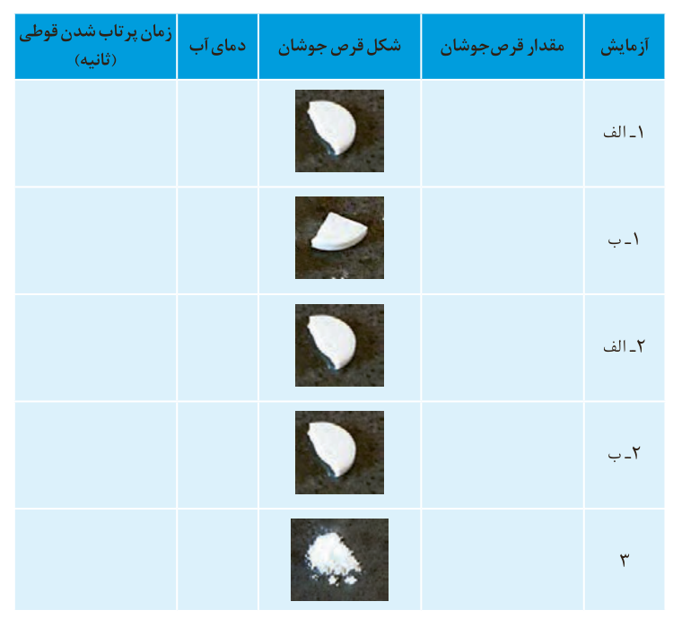

ب) به آن $\frac12$ قرص جوشان بیفزایید و بلافاصله درپوش آن را محکم ببندید سپس آن را وارونه روی زمین قرار دهید.

پ) زمان لازم برای پرتاب شدن قوطی را با استفاده از زمان‌سنج اندازه‌گیری و در جدول داده شده یادداشت کنید.

ت) همین آزمایش را با $\frac14$ قرص جوشان تکرار و زمان را یادداشت کنید.

از مشاهده‌های خود چه نتیجه‌ای می‌گیرید؟

## آزمایش ۲

الف) این بار درون قوطی فیلم عکاسی ۵ mL آب با دمای ۲۵ °C بریزید.

ب) به آن $\frac12$ قرص جوشان بیفزایید و بلافاصله درپوش آن را محکم ببندید سپس آن را وارونه روی زمین قرار دهید.

پ) زمان پرتاب شدن قوطی را اندازه‌گیری و در جدول یادداشت کنید.

ت) این آزمایش را در دمای ۱۰ °C تکرار و نتیجه را در جدول بنویسید.

از مشاهده‌های خود چه نتیجه‌ای می‌گیرید؟

| آزمایش | مقدار قرص جوشان | شکل قرص جوشان | دمای آب | زمان پرتاب شدن قوطی (ثانیه) |
|---|---|---|---|---|
| ۱-الف |  | تصویر نیم قرص |  |  |
| ۱-ب |  | تصویر یک‌چهارم قرص |  |  |
| ۲-الف |  | تصویر نیم قرص |  |  |
| ۲-ب |  | تصویر نیم قرص |  |  |
| ۳ |  | تصویر قرص پودر شده |  |  |

## آیا می‌دانید

در اغلب قرص‌های جوشان افزون بر ویتامین ث، جوش‌شیرین، سیتریک اسید، تارتاریک اسید و ... وجود دارد.
