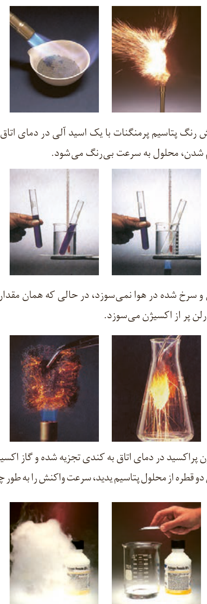

پ) محلول بنفش رنگ پتاسیم پرمنگنات با یک اسید آلی در دمای اتاق به کندی واکنش می‌دهد، اما با گرم شدن، محلول به سرعت بی‌رنگ می‌شود.

ت) الیاف آهن داغ و سرخ شده در هوا نمی‌سوزد، در حالی که همان مقدار الیاف آهن داغ و سرخ شده در یک ارلن پر از اکسیژن می‌سوزد.

ث) محلول هیدروژن پراکسید در دمای اتاق به کندی تجزیه شده و گاز اکسیژن تولید می‌کند، در حالی که افزودن دو قطره از محلول پتاسیم یدید، سرعت واکنش را به طور چشمگیری افزایش می‌دهد.

بیمارانی که مشکلات تنفسی دارند در شرایط اضطراری نیاز به تنفس از کپسول اکسیژن دارند.

برخی افراد با مصرف کلم و حبوبات دچار نفخ می‌شوند زیرا فاقد آنزیمی هستند که آنها را کامل و سریع هضم کند.

