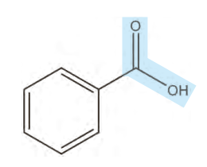

## پیوند با صنعت

با آغاز قرن بیستم، گرایش مردم به شهرنشینی به‌ویژه در کشورهای صنعتی، باعث پدید آمدن شهرهای بزرگ‌تر شد. شهرهایی که در آنها تهیه و تولید غذا به روش سنتی، دیگر پاسخگوی نیازها نبود. در چنین شرایطی ذخیره‌سازی و صادرات غذا به عنوان صنعتی نو خودنمایی کرد. صنعتی که با بهره‌گیری از فناوری‌های گوناگون از جمله بسته‌بندی، کنسروسازی، انجماد و ... به سرعت در سراسر جهان گسترش یافت. اما هنوز شرکت‌های صنایع غذایی با چالش‌هایی در نگهداری و ماندگاری غذا روبه‌رو هستند. افزون بر این فناوری‌ها، استفاده از مواد شیمیایی با ویژگی‌های خاص به عنوان افزودنی‌ها سبب افزایش زمان ماندگاری و کیفیت مواد غذایی شد. افزودنی‌ها، مواد شیمیایی مانند نگهدارنده، رنگ‌دهنده، طعم‌دهنده و ... هستند که به‌صورت هدفمند به مواد خوراکی یا غذاها افزوده می‌شوند. برای نمونه نگهدارنده‌ها، سرعت واکنش‌های شیمیایی که منجر به فساد ماده غذایی می‌شود را کاهش می‌دهند. یکی از این مواد، بنزوئیک اسید است که در تمشک و توت‌فرنگی وجود دارد (شکل ۱۳).

شکل ۱۳- بنزوئیک اسید، یک کربوکسیلیک اسید آروماتیک است.

این ترکیب آلی عضوی از خانواده کربوکسیلیک اسیدهاست. خانواده‌ای که در ساختار هر عضو آن یک یا چند گروه عاملی کربوکسیل ($\mathrm{-COOH}$) وجود دارد. آشناترین عضو آن، اتانوئیک (استیک) اسید با فرمول $\mathrm{CH_3COOH}$ است.

## آیا می‌دانید

در صنایع غذایی برای مواد افزودنی از نمادی به نام عدد E استفاده می‌شود. عددی که نوع ماده افزودنی را نشان می‌دهد. برای نمونه بنزوئیک اسید با E210 و نمک سدیم آن با E212 مشخص می‌شود.

## پیوند با ریاضی

یک تکه زغال چوب به شکل مکعب با طول ضلع ۲ cm در نظر بگیرید. حجم این تکه زغال برابر با $8\,cm^3$، در حالی که مساحت کل آن برابر با $24\,cm^2$ است (چرا؟).

۱- کدام کمیت (حجم یا مساحت کل)، سطح تماس این تکه زغال را با شعله هنگام سوختن نشان می‌دهد؟ توضیح دهید.
