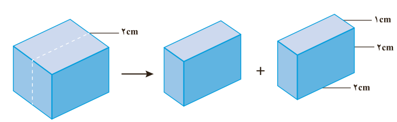

۲- اگر این مکعب از وسط یک ضلع برش بخورد و به دو مکعب مستطیل تقسیم شود، حساب کنید حجم زغال و سطح تماس آن چه تغییری می‌کند؟

۳- براساس تحلیل خود از پرسش‌های بالا، علت تفاوت در سرعت واکنش سوختن تکه زغال با گرد آن را توضیح دهید.

اینک می‌پذیرید که واکنش‌های شیمیایی در طبیعت، صنعت و آزمایشگاه با سرعت‌های متفاوتی انجام می‌شوند. برخی از این واکنش‌ها مانند گوارش، تنفس، تهیه داروها و تولید فرآورده‌های صنعتی مفید و ضروری هستند اما برخی دیگر مانند خوردگی وسایل آهنی، تولید آلاینده‌ها، زرد و پوسیده شدن کاغذ کتاب، زیان‌بار و ناخواسته‌اند. شیمی‌دان‌ها از یک سو در پی یافتن راه‌هایی برای کاهش سرعت یا توقف واکنش‌های ناخواسته‌اند و از سوی دیگر به دنبال سرعت بخشیدن به واکنش‌هایی هستند که بتوانند فرآورده‌های گوناگونی با صرفه اقتصادی تولید کنند. برای دستیابی به چنین اهدافی باید درباره شرایط و چگونگی انجام واکنش‌های شیمیایی و عوامل مؤثر بر سرعت آنها آگاهی داشته باشند. **سینتیک شیمیایی**¹ شاخه‌ای از شیمی است که این آگاهی را در اختیار ما می‌گذارد.

## سرعت تولید یا مصرف مواد شرکت‌کننده در واکنش از دیدگاه کمی

سرعت واکنش در پژوهش‌های علمی، فناوری‌های نو، تولید فرآورده‌های دارویی و ... آن‌چنان اهمیت دارد که باید با دقت اندازه‌گیری و گزارش شود. به دیگر سخن مقایسه دقیق میان سرعت واکنش‌ها هنگامی از صحت و اعتبار علمی برخوردار است که به شکل کمی بیان شود.

از آنجا که در یک واکنش شیمیایی با گذشت زمان، واکنش‌دهنده‌ها مصرف و فرآورده‌ها تولید می‌شوند، می‌توان آهنگ مصرف واکنش‌دهنده‌ها و تولید فرآورده‌ها را در بازه‌ای از زمان

۱- Chemical Kinetics
