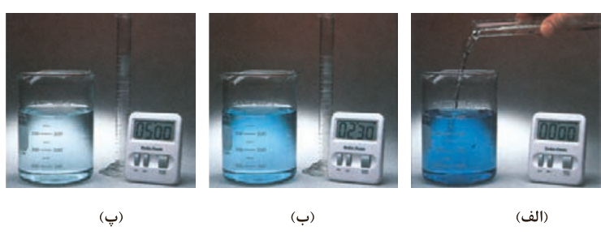
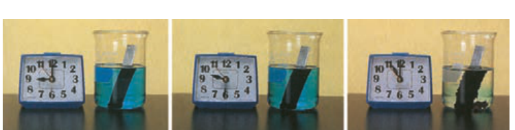

اندازه‌گیری کرد (شکل ۱۴).

شکل ۱۴- واکنش محلول سفیدکننده با ۰/۵ مول نوعی رنگ غذا

در این واکنش با گذشت زمان به تدریج از شدت رنگ محلول کاسته شده تا اینکه در پایان واکنش، محلول تا مرز بی‌رنگ شدن پیش رفته است. این ویژگی بیانگر آن است که مقدار رنگ غذا کاهش می‌یابد و مقدار آن تقریباً به صفر می‌رسد.

## خود را بیازمایید

۱- بر اساس شکل ۱۴، آهنگ مصرف رنگ غذا را برحسب مول بر دقیقه ($mol\,min^{-1}$) حساب کنید.

۲- دانش‌آموزی درون یک محلول محتوی ۰/۰۳ مول مس (II) سولفات، تیغه‌ای از جنس روی قرار داده است. شکل زیر پیشرفت واکنش $\mathrm{Zn(s)}$ با $\mathrm{CuSO_4(aq)}$ را در این آزمایش نشان می‌دهد، با توجه به آن به پرسش‌ها پاسخ دهید.

الف) واکنش‌پذیری فلز روی را با مس مقایسه کنید.

ب) با گذشت زمان مقدار $\mathrm{Cu^{2+}(aq)}$ و $\mathrm{Cu(s)}$ چه تغییری می‌کند؟ چرا؟

پ) اگر شمار مول‌های مصرف شده از هر واکنش‌دهنده در واحد زمان بیانگر سرعت مصرف آن باشد، سرعت مصرف $\mathrm{Cu^{2+}(aq)}$ را برحسب $mol\,min^{-1}$ حساب کنید.

سرعت مصرف یا تولید یک ماده شرکت‌کننده در واکنش در گستره زمانی قابل اندازه‌گیری را سرعت متوسط آن ماده می‌گویند و آن را با $\overline R$ نمایش می‌دهند. از این رو، $\overline R(A)$ سرعت متوسط تولید یا مصرف ماده A را نشان می‌دهد.
