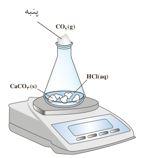

تجربه نشان می‌دهد که سرعت متوسط مصرف یا تولید مواد شرکت‌کننده را می‌توان با اندازه‌گیری کمیت‌هایی مانند جرم، فشار و ... تعیین کرد.

## با هم بیندیشیم

۱- واکنش کلسیم کربنات را با محلول هیدروکلریک اسید در دما و فشار اتاق مطابق شکل روبه‌رو در نظر بگیرید.

$\mathrm{CaCO_3(s)+2HCl(aq)\rightarrow CaCl_2(aq)+CO_2(g)+H_2O(l)}$

جدول زیر، جرم مخلوط واکنش را برحسب زمان برای این آزمایش نشان می‌دهد. با توجه به داده‌های جدول، به پرسش‌های مطرح شده پاسخ دهید:

| زمان (ثانیه) | ۰ | ۱۰ | ۲۰ | ۳۰ | ۴۰ | ۵۰ | ۶۰ |
|---|---|---|---|---|---|---|---|
| جرم مخلوط واکنش (گرم) | ۶۵/۹۸ | ۶۵/۳۲ | ۶۴/۸۸ | ۶۴/۶۶ | ۶۴/۵۵ | ۶۴/۵۰ | ۶۴/۵۰ |
| جرم کربن دی‌اکسید (گرم) | ۰ | ۰/۶۶ | ۱/۱۰ | ...... | ...... | ...... | ...... |

الف) چرا با گذشت زمان از جرم مخلوط واکنش کاسته می‌شود؟

ب) جدول را کامل کنید.

پ) با گذشت زمان جرم گاز آزاد شده چه تغییری می‌کند؟ چرا؟

ت) در چه زمانی واکنش به پایان می‌رسد؟ چرا؟

۲- جدول صفحه بعد را کامل کنید. ($1\,mol\,\mathrm{CO_2}=44\,g$)
