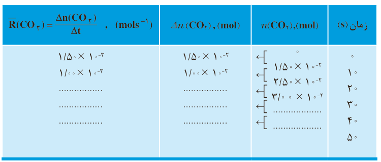

| زمان (s) | $n(\mathrm{CO_2})$ (mol) | $\Delta n(\mathrm{CO_2})$ (mol) | $\overline R(\mathrm{CO_2})=\frac{\Delta n(\mathrm{CO_2})}{\Delta t}$ ($mol\,s^{-1}$) |
|---|---|---|---|
| ۰ | ۰ |  |  |
| ۱۰ | $1/50\times10^{-2}$ | $1/50\times10^{-2}$ | $1/50\times10^{-3}$ |
| ۲۰ | $2/50\times10^{-2}$ | $1/00\times10^{-2}$ | $1/00\times10^{-3}$ |
| ۳۰ | $3/00\times10^{-2}$ | ............ | ............ |
| ۴۰ | ............ | ............ | ............ |
| ۵۰ | ............ | ............ | ............ |

۳- نمودار مول-زمان را برای گاز $\mathrm{CO_2}$ بر روی کاغذ میلی‌متری زیر رسم کنید.

[شبکه نمودار خالی]

۴- سرعت متوسط تولید $\mathrm{CO_2}$ با گذشت زمان چه تغییری می‌کند؟ چرا؟

۵- آزمایش نشان می‌دهد که نمودار مول-زمان برای هر سه فرآورده در واکنش کلسیم کربنات با محلول هیدروکلریک اسید از هر لحاظ یکسان است. چرا؟

اگر شمار مول‌های یک ماده را با n نمایش دهیم، $\Delta n=n_2-n_1$ تغییر تعداد مول‌های آن ماده را نشان می‌دهد. $\Delta n>0$ افزایش شمار مول‌های فرآورده و $\Delta n<0$ کاهش شمار مول‌های واکنش‌دهنده را در واکنش نشان می‌دهد.

## آیا می‌دانید

R حرف اول واژه Rate به معنای نرخ، آهنگ یا سرعت است.

## سرعت متوسط و شیب نمودار مول-زمان

با چگونگی محاسبه سرعت متوسط تولید فرآورده در یک واکنش شیمیایی آشنا شدید. نمودار ۸، نمودار مول-زمان را برای کلسیم کلرید تولید شده در واکنش کلسیم کربنات با محلول هیدروکلریک اسید نشان می‌دهد.
