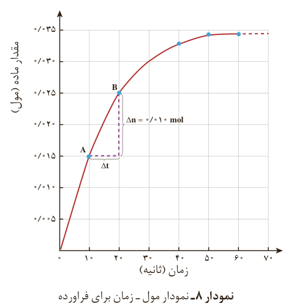

نمودار ۸- نمودار مول-زمان برای فرآورده

در نمودار ۸، نقطه A نشان می‌دهد که در زمان $t_1=10s$، مول‌های کلسیم کلرید برابر با $n_1=0/015mol$ و نقطه B نشان می‌دهد که در زمان $t_2=20s$، مول‌های این ماده برابر با $n_2=0/025mol$ است. از این رو:

$\Delta n(\mathrm{CaCl_2})=n_2-n_1=0/025mol-0/015mol=0/010mol$

این مقدار، تغییر مول‌های کلسیم کلرید را در گستره زمانی ۱۰ تا ۲۰ ثانیه ($\Delta t=t_2-t_1=20s-10s=10s$) نشان می‌دهد. نسبت $\frac{\Delta n}{\Delta t}$، شیب خط AB در نمودار مول-زمان است. این نسبت علامت مثبت دارد و سرعت متوسط تولید کلسیم کلرید را در بازه زمانی ۱۰ تا ۲۰ ثانیه مشخص می‌کند.

نمودار ۸ همچنین نشان می‌دهد هر چه واکنش به پایان آن نزدیک‌تر می‌شود، شیب نمودار مول-زمان کندتر شده تا اینکه از ثانیه ۵۰ به بعد برابر با صفر می‌شود. از این‌رو، می‌توان نتیجه گرفت این واکنش با گذشت ۵۰ ثانیه به پایان رسیده است و پس از آن دیگر فرآورده‌ای تولید نمی‌شود.

برای درک بهتر روند پیشرفت واکنش با زمان می‌توان در نمودار مول-زمان از دو کمیت بهره برد. یکی عرض از مبدأ که مقدار آغازی ماده شرکت‌کننده را نشان می‌دهد و دیگری شیب نمودار که متناسب با سرعت متوسط مصرف یا تولید آن ماده در گستره زمانی معین است.

## خود را بیازمایید

۱- در واکنش $\mathrm{CaCO_3(s)}$ با $\mathrm{HCl(aq)}$، چه رابطه‌ای بین سرعت متوسط مصرف این دو ماده وجود دارد؟ این رابطه را بنویسید.
