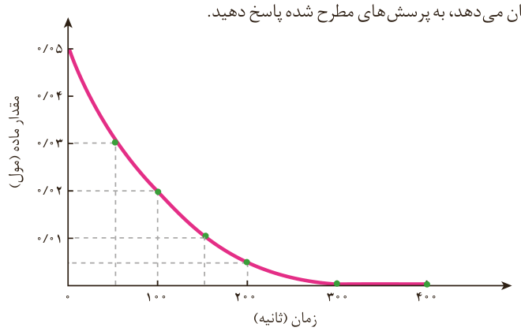

۲- یکی از آلاینده‌های هوا که باعث تولید باران اسیدی می‌شود، گاز گوگرد تری‌اکسید است که مطابق واکنش زیر تولید می‌شود:

$\mathrm{2SO_2(g)+O_2(g)\rightarrow 2SO_3(g)}$

اگر در شرایط معین $\overline R(\mathrm{O_2})=0/01\,mol\,s^{-1}$ باشد، $\overline R(\mathrm{SO_3})$ و $\overline R(\mathrm{SO_2})$ را بر حسب $mol\,min^{-1}$ حساب کنید.

۳- با توجه به نمودار زیر که تغییر مول‌های نوعی رنگ غذا در واکنش با یک محلول سفیدکننده را نشان می‌دهد، به پرسش‌های مطرح شده پاسخ دهید.

الف) مول‌های واکنش‌دهنده (رنگ غذا) با گذشت زمان چه تغییری می‌کند؟ چرا؟

ب) شیب نمودار مول-زمان چه علامتی دارد؟ چرا؟

پ) توضیح دهید چرا علامت منفی در رابطه زیر نوشته می‌شود.

$\overline R(\text{واکنش‌دهنده})=-\frac{\Delta n(\text{واکنش‌دهنده})}{\Delta t}$

ت) سرعت متوسط مصرف رنگ غذا را برحسب مول بر دقیقه حساب کنید.

## پیوند با زندگی

### خوراکی‌های طبیعی رنگین، بازدارنده‌هایی مفید و مؤثر

یافته‌ها و شواهد تجربی نشان می‌دهد که برنامه غذایی محتوی سبزیجات و میوه‌های گوناگون، نقش بازدارندگی مؤثری در برابر سرطان‌ها و پیری زودرس دارند. این یافته‌ها
