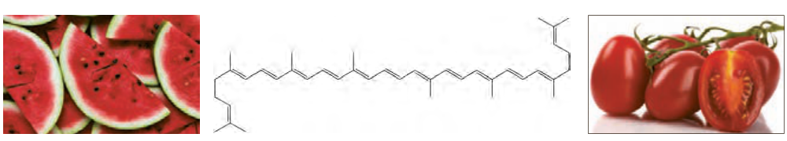
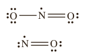

دانشمندان و شیمی‌دان‌ها را بر آن داشت تا بررسی کنند چه موادی در سبزیجات و میوه‌ها این مهم را به عهده دارند. نتیجه پژوهش‌های علمی نشان داد که این خوراکی‌ها محتوی ترکیب‌های آلی سیرنشده‌ای به نام ریزمغذی‌ها هستند، ترکیب‌هایی که در حفظ سلامت بافت‌ها و اندام‌ها دخالت دارند، هر چند نقش کامل این مواد هنوز به‌طور دقیق مشخص نشده است اما برخی از آنها به عنوان بازدارنده از انجام واکنش نامطلوب و ناخواسته به‌دلیل حضور رادیکال‌ها جلوگیری می‌کنند.

رادیکال، گونه فعال و ناپایداری است که در ساختار خود، الکترون جفت نشده دارد، در واقع محتوی اتم‌هایی است که از قاعده هشت‌تایی پیروی نمی‌کنند. بدیهی است که رادیکال‌ها واکنش‌پذیری بالایی دارند.

در بدن ما به‌دلیل انجام واکنش‌های متنوع و پیچیده، رادیکال‌هایی به‌وجود می‌آیند که اگر به‌وسیله بازدارنده‌ها جذب نشوند، می‌توانند با انجام واکنش‌های سریع به بافت‌های بدن آسیب برسانند. با این توصیف مصرف خوراکی‌های محتوی بازدارنده‌ها سبب خواهد شد که رادیکال‌ها به دام بیفتند تا با کاهش مقدار آنها از سرعت واکنش‌های ناخواسته کاسته شود (شکل ۱۵).

شکل ۱۵- هندوانه و گوجه‌فرنگی محتوی لیکوپن بوده که فعالیت رادیکال‌ها را کاهش می‌دهد.

## آیا می‌دانید

رادیکال‌ها نه تنها در بدن بلکه در محیط زندگی نیز وجود دارند. برای نمونه هوای آلوده دارای رادیکال‌های NO و $\mathrm{NO_2}$ با ساختارهای لوییس زیر است.

## در میان تارنماها

با مراجعه به منابع علمی معتبر درباره ساختار و نقش بازدارنده‌هایی مانند فلاوونوئید، آنتوسیانین، بتاکاروتن و ... در میوه‌ها و سبزیجات محتوی آنها اطلاعاتی جمع‌آوری و در کلاس ارائه کنید.

## خود را بیازمایید

در نمودار داده شده، منحنی A نشان‌دهنده تغییر مول‌های یکی از مواد فرآورده در واکنش فرضی است. با دلیل مشخص کنید کدام منحنی (B یا C) نشان‌دهنده افزودن بازدارنده و کدام یک نشان‌دهنده افزودن کاتالیزگر به سامانه واکنش است؟
