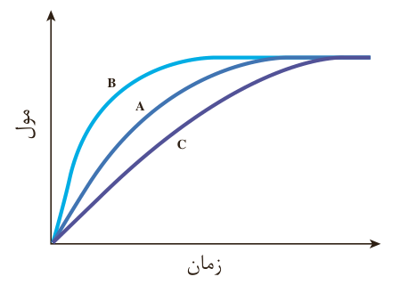

## سرعت واکنش

دریافتید که شیب نمودار مول-زمان برای هر یک از شرکت‌کننده‌ها در واکنش، متناسب با ضریب استوکیومتری آن است. به طوری که اگر ضریب استوکیومتری شرکت‌کننده‌ها یکسان نباشد، سرعت متوسط آنها متفاوت خواهد بود. شیمی‌دان‌ها برای درک آسان پیشرفت واکنش در واحد زمان، از یک مفهوم کاربردی به نام سرعت واکنش استفاده می‌کنند.

## با هم بیندیشیم

۱- سرعت متوسط تولید گاز آمونیاک در شرایط معینی بر اساس معادله واکنش زیر در گستره زمانی معینی برابر با $4\times10^{-2}\,mol\,s^{-1}$ است.

$\mathrm{N_2(g)+3H_2(g)\rightarrow 2NH_3(g)}$

الف) سرعت متوسط مصرف $\mathrm{N_2(g)}$ و $\mathrm{H_2(g)}$ را در این گستره زمانی حساب کنید.

ب) سرعت متوسط تولید یا مصرف هر شرکت‌کننده را به ضریب استوکیومتری آن تقسیم کنید. از حاصل این تقسیم‌ها چه نتیجه‌ای می‌گیرید؟

پ) حاصل تقسیم در قسمت ب، سرعت واکنش نام دارد. برای این واکنش با استفاده از سرعت متوسط تولید یا مصرف مواد شرکت‌کننده، رابطه سرعت واکنش را بنویسید.

ت) ارتباط معادله شیمیایی موازنه شده واکنش را با رابطه زیر توضیح دهید.

ث) سرعت متوسط کدام ماده با سرعت واکنش برابر است؟ توضیح دهید.

$R(\text{واکنش})=+\frac{\Delta n(\mathrm{NH_3})}{2\Delta t}=-\frac{\Delta n(\mathrm{H_2})}{3\Delta t}=-\frac{\Delta n(\mathrm{N_2})}{\Delta t}$

یک ویژگی سرعت واکنش این است که به ضریب‌های استوکیومتری مواد شرکت‌کننده در واکنش وابسته نیست.
