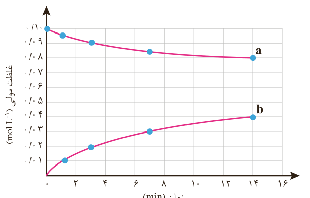

۲- قند موجود در جوانه گندم (مالتوز) مطابق واکنش زیر به گلوکز تبدیل می‌شود.

$\mathrm{C_{12}H_{22}O_{11}(aq)+H_2O(l)\rightarrow 2C_6H_{12}O_6(aq)}$

این واکنش در دمای ثابت و شرایط معین بررسی شده و جدول زیر، داده‌های تجربی آن را نشان می‌دهد. با توجه به آن و نمودار داده شده، به پرسش‌های زیر پاسخ دهید.

| زمان (دقیقه) | ۰ | ۱ | ۳ | ۷ | ۱۴ |
|---|---|---|---|---|---|
| $[\mathrm{C_6H_{12}O_6}]$ ($mol\,L^{-1}$) | ۰ | ۰/۰۱ | ۰/۰۲ | ۰/۰۳ | ۰/۰۴ |
| $[\mathrm{C_{12}H_{22}O_{11}}]$ ($mol\,L^{-1}$) | ۰/۱۰ | ۰/۰۹۵ | ۰/۰۹ | ۰/۰۸۵ | ۰/۰۸ |

الف) در سه دقیقه نخست، $\overline R$(گلوکز) و $\overline R$(مالتوز) را برحسب $mol\,L^{-1}s^{-1}$ حساب کنید.

ب) سرعت واکنش را در هفت دقیقه نخست و هفت دقیقه دوم حساب کنید. کدام یک بیشتر است؟ چرا؟

پ) هر یک از منحنی‌های a و b مربوط به کدام ماده شرکت‌کننده است؟ توضیح دهید.

سمنو که از جوانه گندم تهیه می‌شود محتوی مواد غذایی گوناگونی از جمله مالتوز است.

برای شرکت‌کننده‌ها در حالت گاز و محلول، می‌توان سرعت متوسط مصرف یا تولید را افزون بر یکای مول بر زمان با یکای مول بر لیتر بر زمان نیز گزارش کرد.

غلظت مولی یک ماده را با نوشتن فرمول شیمیایی آن درون یک کروشه نمایش می‌دهند. غلظت مولی A = [A]

## غذا، پسماند و ردپای آن

زندگی ما و ادامه آن بر روی زمین به تأمین نیازهای ضروری مانند هوا، آب، غذا و... وابسته است. اما میزان نیاز و بهره‌مندی از این منابع برای همه یکسان نیست. دلیل این تفاوت را باید
