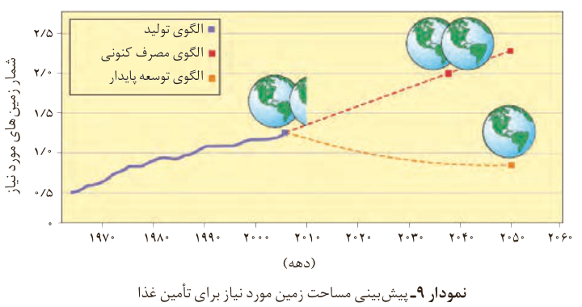

در سبک زندگی هر فرد جستجو کرد زیرا هر انسان در طول عمر خود، ردپاهای متفاوتی در محیط‌زیست بر جای می‌گذارد.

در شیمی دهم با ردپای کربن دی‌اکسید و آب آشنا شدید. ردپاهایی که دو چهره آشکار و پنهان دارند. پدیده دو چهره دیگری از این دست، ردپای غذا است. چهره آشکار آن نشان می‌دهد که سالانه حدود ۳۰٪ غذایی که در جهان فراهم می‌شود به مصرف نمی‌رسد و به زباله تبدیل می‌شود و یا از بین می‌رود. این درحالی است که آمارها نشان می‌دهد که به‌ازای هر هفت نفر در جهان، یک نفر گرسنه است! خبری که هدررفتن منابع اقتصادی را آشکار می‌سازد. اما چهره پنهان این ردپا شامل همه منابعی است که در تهیه غذا از آغاز تا سر سفره سهم داشته‌اند. مدیریت منابع، نیروی انسانی برای تولید و تأمین مواد اولیه و انرژی، فراوری، ابزار و دستگاه‌های مورد نیاز، بسته‌بندی، حمل‌ونقل، آب و انرژی مصرفی، زمین‌های بایر و ... از جمله این منابع هستند.

چهره پنهان این ردپا، تولید گازهای گلخانه‌ای به‌ویژه کربن دی‌اکسید است، آن‌چنان که سهم تولید این گاز در ردپای غذا به‌مراتب بیش از سوختن سوخت‌ها در خودروها، کارخانه‌ها و... است.

از آنجا که جمعیت جهان، رشد اقتصادی، سطح رفاه و... رو به افزایش است، تقاضا برای غذا نیز پیوسته افزایش می‌یابد. تقاضایی که برای تأمین آن، منابع آب، انرژی، مواد اولیه و زمین بیشتری را می‌طلبد. بدیهی است که با این روند ردپای غذا روی محیط‌زیست سنگین‌تر شده و مساحت کل مورد نیاز برای تأمین اقلام ضروری زندگی بیشتر خواهد شد (نمودار ۹).

نمودار ۹- پیش‌بینی مساحت زمین مورد نیاز برای تأمین غذا. الگوی تولید، الگوی مصرف کنونی و الگوی توسعه پایدار.

با توجه به الگوی تولید و مصرف غذا انتظار می‌رود مدیران جامعه جهانی با طراحی و انتخاب راه‌حل‌های اجرایی مناسب و هماهنگ، بهره‌وری را در مراحل تولید و تأمین غذا

## آیا می‌دانید

فائو برآورد می‌کند که ۳۰٪ مواد غذایی تولید شده یعنی حدود ۱/۳ میلیارد تن در سال از بین رفته یا به زباله تبدیل می‌شود.
